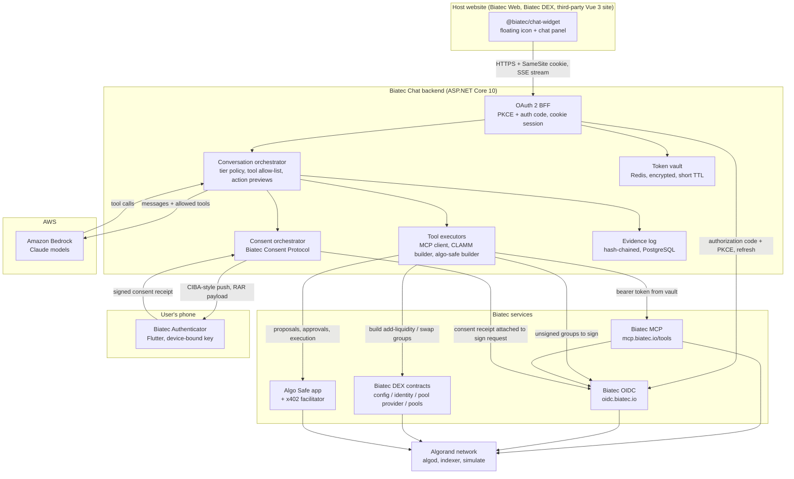

# Biatec Chat

**Conversational, consent-gated access to self-custody finance on Algorand.**

Biatec Chat is an embeddable AI assistant that lives in the bottom-right corner of Biatec web properties (Biatec Web, Biatec DEX) and, through an npm package, any third-party Vue 3 site. Visitors can ask the assistant to explain the products and the blockchain. Signed-in users can ask it to act: transfer funds from their self-custody addresses (to their own other addresses or anywhere else), swap assets, add liquidity to a Biatec DEX pool, or create and govern a Biatec Safe shared account. Every action that moves user funds flows through the user's own Biatec OIDC identity, the user's own spending limits, and, above a configurable threshold, an explicit approval on the user's phone in the Biatec Authenticator app.

The assistant never holds keys, never sees long-lived tokens, and never acts outside what the user has authorized.

* Chat that discovers capabilities for anyone, and executes only for authenticated, consenting users
* A backend that keeps every credential out of the browser and every transaction in an evidence log
* A mobile authenticator and an open consent protocol so banks and other third parties can integrate without asking permission, yet users cannot be tricked by impostors

---

## Why This Product

Biatec already has the hard parts of self-custody finance:

- **Biatec OIDC** (`https://oidc.biatec.io`) is an OpenID Connect provider and a self-custody wallet API. Users sign in with Google or Microsoft, their Algorand/EVM/Bitcoin keys are derived and encrypted into their own cloud storage, and third-party clients can request transaction signing under user-controlled daily, weekly, and monthly spending limits.
- **Biatec MCP** (`https://mcp.biatec.io/tools`) exposes that wallet to AI assistants over the Model Context Protocol as an OAuth 2.1 resource server. It builds, signs, and submits payments, opt-ins, swaps, bridges, multisig, and Bitcoin transactions, chained as three separate steps so an unsigned transaction can be inspected before it is ever broadcast.
- **Biatec DEX** (BiatecCLAMM) is a concentrated-liquidity AMM on Algorand, shipped as the `biatec-concentrated-liquidity-amm` npm package with `clammAddLiquiditySender`, `clammSwapSender`, and `clammRemoveLiquiditySender` helpers.
- **Algo Safe** is a policy-driven smart account with M-of-N signer groups, transaction proposals, spending limits, and an x402 payment facilitator for the agent economy.
- **Biatec Web** is a Vue 3 + PrimeVue marketing and product site deployed to Kubernetes.

What is missing is the front door. Today a user has to know which product does what, where the buttons are, and how a transaction group is assembled. Biatec Chat turns that into a conversation, and does it without weakening any of the security properties the underlying services already enforce.

---

## Product Vision

Biatec Chat should feel like talking to a knowledgeable, careful banker who happens to be available on every Biatec page.

- A visitor should get accurate answers about what Biatec offers, without being asked to sign in.
- A signed-in user should be able to say "swap 100 USDC to EURS" or "add liquidity to the EURS/USDC pool" and see a clear preview of exactly what will happen on-chain before anything is signed.
- A high-value action should pause and appear on the user's phone, with the same amount, asset, and destination the chat showed, for an approval that cannot be faked by a malicious website or a compromised browser tab.
- A team should be able to create a Biatec Safe in chat, have one member propose a transaction, and have another member approve it from their own session.
- Every one of those actions should leave a tamper-evident trail: what was asked, what the model proposed, what the user consented to, and which transaction landed on-chain.

Longer term, the same backend, consent protocol, and authenticator serve agents that are not chat at all: scheduled automations, agent-to-agent payments over x402, and third-party banks or fintechs that want Biatec users to approve their requests on the same trusted device.

---

## Products In This Monorepo

| Product | Package / project | Stack | Purpose |
| --- | --- | --- | --- |
| Chat widget | `@biatec/chat-widget` (npm) | Vue 3, TypeScript, Vite library build | Floating chat icon and chat panel injected into Biatec Web, Biatec DEX, and any Vue 3 host |
| Chat backend | `Biatec.Chat.Api` | ASP.NET Core 10 (.NET), AWS Bedrock, Redis, PostgreSQL | OAuth 2 BFF, model orchestration, tool execution via Biatec MCP, session recording, evidence log, consent orchestration |
| Authenticator | `biatec_authenticator` | Flutter (iOS, Android) | Device-bound approval of high-value actions and sign-in; reference implementation of the Biatec Consent Protocol |

Shared pieces:

- `packages/chat-protocol`: the typed JSON contract between widget and backend (messages, suggestions, action previews, consent status), generated from the backend's OpenAPI document.
- `packages/consent-protocol`: the Biatec Consent Protocol specification, JSON schemas, test vectors, and a conformance test suite that any third-party integrator can run.
- `docs/`: architecture, threat model, integration guides, hackathon demo script.

---

## Core Concepts

### Session Tiers

Every chat session is in exactly one tier. The tier determines which tools the model may call and which prompts the backend will refuse.

| Tier | How it is reached | What the assistant may do |
| --- | --- | --- |
| **Anonymous** | Widget loads, no sign-in | Capability discovery only: explain Biatec products, Algorand, DEX concepts, fees, how to get started. No account data, no transaction building, no price-sensitive advice beyond public facts. |
| **Authenticated** | User completes Biatec OIDC login (PKCE + authorization code) through the backend | Everything above, plus read own addresses and balances, build and preview transactions, sign and submit transactions within the user's own spending limits, create safes and proposals. |
| **Consent-elevated** (per action, not a session state) | A specific action exceeds a policy threshold, or is always-consented, and the user approves it in Biatec Authenticator | That one action, with the exact parameters the user approved, for a short validity window. Elevation is per action, never per session; the session stays Authenticated. |

An anonymous session that receives an action request is not escalated silently. The assistant explains that the request needs sign-in, shows what the action would do in general terms, and offers the sign-in button. The backend enforces this independently of the model: in the anonymous tier the tool list sent to the model contains no wallet tools, and any tool call that slips through is rejected server-side.

### Capabilities And Intents

A capability is a named, versioned thing the assistant can do. Each capability declares the minimum tier, the scopes it needs on the Biatec OIDC access token, whether it moves funds, and how its value is computed for the consent threshold.

Initial capability set:

| Capability | Tier | Scopes | Moves funds | Backed by |
| --- | --- | --- | --- | --- |
| `explain.product`, `explain.blockchain` | Anonymous | none | no | Model knowledge plus a curated knowledge base of Biatec docs |
| `wallet.listAddresses`, `wallet.balance` | Authenticated | `openid` | no | Biatec MCP `listAlgorandAddresses`, `getCryptoAddress`, `getCryptoBalance` |
| `wallet.transfer` | Authenticated | `sign` | yes | Built by Biatec MCP `createPaymentTransaction` (native ALGO or any ASA such as EURS and USDC, with `createOptInTransaction` first when the receiver is the user's own un-opted address) or `createBitcoinTransaction`; signed by the backend directly at Biatec OIDC `POST /wallet/{network}/{address}/sign`; broadcast by Biatec MCP `submitTransactionToBlockchain` |
| `dex.swap` | Authenticated | `sign` | yes | Built by Biatec MCP `createSwapTransaction` (quote aggregation across Biatec Router and other providers, preferring Biatec DEX pools); signed directly at Biatec OIDC; broadcast by Biatec MCP |
| `dex.addLiquidity`, `dex.removeLiquidity` | Authenticated | `sign` | yes | Built by the backend with `biatec-concentrated-liquidity-amm`; signed directly at Biatec OIDC; broadcast by the backend through algod |
| `safe.create`, `safe.addSignerGroup` | Authenticated | `sign` | yes (app funding) | `algo-safe` npm library |
| `safe.propose` | Authenticated | `sign` | no (proposal only, nothing moves) | `algo-safe` proposal builder |
| `safe.approve` | Authenticated | `sign` | yes (authorizes the safe's spend; value = the proposal payload's value) | `algo-safe` `approveProposal` with `expectedPayloadVersion` |
| `safe.execute` | Authenticated | `sign` | no (permissionless once the threshold is met; value already consented by approvers) | `algo-safe` `executeProposal` |
| `limits.view` | Authenticated | `openid` | no | Biatec OIDC `GET /wallet/limits` |
| `limits.update` | Authenticated, always consent-elevated | `manage-limits` | no, but raises risk | Biatec OIDC `PUT /wallet/limits`, which issues the same step-up challenge as signing, with a `biatec_limits_change` authorization detail hashed over the canonical request body |
| `x402.pay` | Authenticated | `sign` | yes (value = the x402 price converted at Biatec OIDC rates) | `algo-safe` x402 client and facilitator; behind a feature flag until after the hackathon |

Capabilities deliberately excluded from chat in version 1: anything requiring the `rekey` scope, asset creation, bridge transactions, and any action whose source address is not one the user's Biatec OIDC identity controls. Destinations may be any address or application (another of the user's own addresses, a safe, a pool, an x402 payee) and are always shown in full on the preview. These can be added later as separate capabilities with their own consent rules.

The value used for the consent threshold is always computed by Biatec OIDC from the transaction group itself, never taken from the chat backend. For a safe approval, Biatec OIDC reads the proposal payload from the safe's on-chain boxes and values that payload, because the approval app call is what authorizes the spend even though the approver's own balance does not move.

Signing is never delegated to Biatec MCP's `signTransaction` tool. Biatec MCP is used to build transactions, read balances and addresses, and broadcast signed bytes; every signature request goes from the backend straight to Biatec OIDC, so the step-up challenge described under the consent protocol always reaches the backend and can be completed.

### Action Preview

Every capability that moves funds produces an **action preview** before anything is signed. The preview is a structured object rendered by the widget as a card, not free text from the model:

- Human-readable intent ("Swap 100 USDC for at least 91.80 EURS on Biatec DEX")
- Network and genesis ID
- Source address and destination (or pool application ID)
- Assets, amounts, decimals, and the fiat value used for policy decisions
- Fees and slippage settings
- Simulation result from `algod` simulate where available
- Which spending-limit bucket the action counts against and how much headroom remains
- Whether the action needs authenticator approval and why

The user confirms the preview in the widget. For consent-elevated actions, the phone shows the same facts, but not the backend's preview: Biatec OIDC decodes the unsigned transaction group itself and renders the card from what it decoded.

The value that binds every later step is the **group hash**: SHA-256 over the canonical encoding of the exact unsigned transaction group (for a safe approval, the group hash plus the proposal ID and payload version it approves). The backend derives the preview from the group, the consent receipt signs the group hash, the signing request carries the same group, and the evidence record stores the hash next to the submitted transaction IDs. A group that differs by one byte from the consented one has a different hash and is refused by Biatec OIDC.

### Evidence Record

Every session produces an append-only evidence record. Each entry commits to its content through a salted payload hash (`payloadHash = SHA-256(salt, payload)` with a fresh 32-byte random salt per entry), and the chain hashes over those commitments (`entryHash = SHA-256(prevHash, kind, payloadHash)`). A transcript cannot be edited after the fact without detection, and a payload and its salt can later be deleted together for privacy while the chain still verifies and the retained hash reveals nothing about the deleted content.

Recorded per session:

- Session metadata: tier changes, client application, widget version, timestamps, coarse geolocation if the host site provides it
- Every user message and assistant message, including the model's tool calls and tool results (secrets redacted by schema, not by regex)
- Every action preview, its canonical hash, and the user's confirmation
- Every consent request and consent receipt from the authenticator, including the device key identifier and signature
- Every signing request to Biatec OIDC and its outcome, including spending-limit decisions
- Every submitted transaction ID, confirmation round, and final on-chain status

Evidence is exportable by the user as a signed JSON bundle and is the basis for dispute handling, audits, and the hackathon demonstration.

---

## Architecture



**Boundary rules**

- The widget never receives an access token, refresh token, ID token, or authorization code. It only ever holds an opaque, HTTP-only, `Secure`, `SameSite=Lax` session cookie issued by the backend, and that cookie is always first-party to the page the widget runs on (see Embedding Modes).
- The backend is the only OAuth client. Each tenant host (Biatec's own sites together form one tenant) is registered with Biatec OIDC as its own confidential client with PKCE enforced in addition to its client secret, so the authenticator can tell tenants apart.
- Model calls go to Amazon Bedrock from the backend only. The widget never talks to Bedrock, and no Bedrock credential leaves the backend's AWS role.
- Transaction building uses the official builders: Biatec MCP tools for payments, Bitcoin transfers, and swaps; `biatec-concentrated-liquidity-amm` for liquidity; `algo-safe` for safes. The backend never hand-assembles transaction groups.
- Signing always happens inside Biatec OIDC. The backend sends unsigned transaction groups and receives signed bytes; it never sees key material.

---

## Chat Widget (`@biatec/chat-widget`)

### Packaging

- Published to npm as `@biatec/chat-widget`, ESM and UMD builds, Vue 3 as a peer dependency.
- Installed with one plugin call in the host application:

```ts
import { createApp } from 'vue'
import { BiatecChat } from '@biatec/chat-widget'
import '@biatec/chat-widget/style.css'

createApp(App)
  .use(BiatecChat, {
    backendUrl: 'https://chat.biatec.io',
    clientKey: 'biatec-web',          // identifies the host, not a secret
    locale: 'en',
    theme: 'auto',
    suggestions: 'default',
  })
  .mount('#app')
```

- Styles are scoped under a `biatec-chat` root with CSS custom properties, so the widget does not fight the host's PrimeVue theme in Biatec Web or any other design system.
- No host-page data is read by default. A host can opt in to pass a page context string (for example the pool currently shown on Biatec DEX) that the assistant may use to pre-fill suggestions.

### Embedding Modes

The session cookie must be first-party to the page, because the widget never relies on third-party cookies. Two modes satisfy that:

- **Biatec sites.** Biatec Web and Biatec DEX run under `biatec.io` subdomains and the backend runs at `chat.biatec.io`. Browser requests from `web.biatec.io` or `dex.biatec.io` to `chat.biatec.io` are same-site, so the cookie is sent.
- **Third-party hosts.** A third party exposes the backend under its own site, either by pointing a subdomain such as `chat.example-bank.com` at the Biatec Chat backend (the backend is multi-tenant by `Host` header and scopes the cookie to that host) or by reverse-proxying a path such as `/biatec-chat/` to it. The widget's `backendUrl` is then same-site with the host page. A host that cannot do either cannot run the authenticated tier; the widget detects a cross-site `backendUrl` at startup and stays in the anonymous tier with a console warning.

The cookie is `SameSite=Lax`, not `Strict`, on every tenant. For a third-party tenant the authorization-code callback from `oidc.biatec.io` to `chat.example-bank.com` is a cross-site top-level navigation and must carry the cookie to find the pending `state` and PKCE verifier; Strict would drop it. For the Biatec tenant the callback happens to be same-site, so Strict would appear to work in testing, which is exactly why Lax is mandated uniformly rather than left to per-tenant configuration. Lax still withholds the cookie on every cross-site request that is not a top-level navigation, and every state-changing endpoint additionally requires the custom header and origin check described under Security Model.

Each tenant is a separate Biatec OIDC client with its own `client_id`, client secret, redirect URI, and (optionally) OpenID Federation entity statement. A tenant is created by a Biatec Chat operator or by the tenant itself through the self-service onboarding endpoint, which registers the client at Biatec OIDC through RFC 7591 Dynamic Client Registration and stores the resulting credentials in the backend's secret store under that tenant. Biatec's own sites share one tenant, "Biatec Chat". Because the OIDC client is the tenant, the consent card on the phone names the tenant, the user's per-client thresholds and pauses apply to that tenant alone, and a hostile host cannot borrow Biatec's name.

### User Experience

1. **Launcher**: a round chat icon in the bottom-right corner. Keyboard accessible, respects `prefers-reduced-motion`, and can be positioned by the host.
2. **Panel**: opens as a drawer on desktop and full-screen on mobile. Header shows the Biatec logo, the current tier ("Guest" or the signed-in email with the active primary address), and a sign-in or sign-out control.
3. **Sample prompts** shown on an empty session, chosen by tier and host context:
   - "Explain to me what the blockchain is and why Biatec uses Algorand."
   - "Transfer funds from my primary Bitcoin address to my secondary Bitcoin address."
   - "Add liquidity to the Biatec DEX EURS/USDC pool."
   - "Swap 50 USDC to ALGO."
   - "Create a Biatec Safe for my team with 2-of-3 approvals."
   - "What are my current spending limits?"
4. **Streaming replies** over Server-Sent Events, with tool progress shown as compact status lines ("Checking your USDC balance", "Simulating transaction group").
5. **Action preview card** with Confirm and Cancel. A consent-elevated action shows a "Waiting for approval on your phone" state with a countdown, the same short binding code that the authenticator displays, and a Cancel button.
6. **Sign-in handoff**: clicking Sign in opens a backend URL in a popup; the backend redirects to Biatec OIDC and back. The widget never sees the OAuth parameters. Each popup flow has an authorization request ID; the widget polls the backend's session endpoint until that request is reported complete (or failed), then closes the popup and resumes whatever the user was doing. The same popup mechanism is reused when a capability needs a scope the session does not have yet (for example the first fund-moving action needs `sign`), so the chat context is never lost to a full-page redirect.
7. **Receipts**: after an action completes, the card shows the transaction ID with an explorer link, and a "Download evidence" link for the session.

### Accessibility And Localization

- WCAG 2.1 AA: focus trapping in the panel, ARIA live region for streamed messages, visible focus styles, contrast-checked theme tokens.
- Localization through the same `vue-i18n` message format Biatec Web already uses, with English and Slovak at launch.

---

## Chat Backend (`Biatec.Chat.Api`)

### Responsibilities

- Terminate the browser session and act as the OAuth 2 Backend-for-Frontend (BFF).
- Run the conversation loop against Amazon Bedrock with a per-tier tool allow-list.
- Execute tools against Biatec MCP, Biatec OIDC, Biatec DEX libraries, and the `algo-safe` library.
- Compute action previews, simulate transaction groups, and apply consent policy.
- Drive the Biatec Consent Protocol towards the authenticator.
- Record sessions and evidence.
- Expose health, metrics, and an admin API for policy and knowledge-base management.

### Model Layer

- Model access is through Amazon Bedrock, so no Anthropic API key is stored anywhere. The backend's AWS role is scoped to `bedrock:InvokeModel` and `bedrock:InvokeModelWithResponseStream` on the allowed model identifiers.
- The default model is the current Claude Opus generation available on Bedrock, with the Claude Sonnet generation configured as the cost-saving option for anonymous capability-discovery sessions. Model identifiers are configuration, not code.
- Every request carries a system prompt built from three stable parts, in this order, so Bedrock prompt caching stays effective: the Biatec persona and refusal rules, the tier's capability catalogue, and the curated knowledge-base excerpts. Volatile data (balances, quotes, timestamps) goes into tool results, never into the system prompt.
- The backend owns the tool loop. The model proposes a tool call; the orchestrator validates the call against the tier allow-list and the JSON schema, executes it, and returns the result. A tool call that fails validation returns an error result to the model and is logged as a policy event.
- Prompt injection defense: content that comes from outside the user (knowledge-base pages, token names, on-chain notes, host page context) is wrapped as untrusted data in tool results. The system prompt instructs the model that such content never changes the tier or the action. The backend enforces the same rule regardless of what the model does.

### Tier Enforcement

Enforcement is layered so a model mistake cannot become a security incident:

1. **Tool visibility**: the anonymous tier's request to Bedrock contains only the `explain.*` tools and the knowledge-base search tool.
2. **Server-side gate**: every tool call is checked against the session tier, the token's scopes, and the capability registry before execution.
3. **Refusal content**: when a prompt in the anonymous tier asks for an action, the orchestrator short-circuits with a templated refusal plus the sign-in control, and logs the attempt. The model is still asked to phrase the explanation, but it cannot change the outcome.
4. **Scope check at execution**: before calling Biatec MCP or Biatec OIDC, the backend inspects the stored access token's `scope` claim. A capability whose scope is missing is refused with a message that offers to re-authorize with the needed scope.

### Tool Executors

- **MCP client**: a Model Context Protocol client that connects to `https://mcp.biatec.io/tools` with the user's bearer token. Tools are discovered at startup and mapped onto chat capabilities. The chain is always build (MCP), then preview, then sign (Biatec OIDC directly), then submit (MCP or algod); the MCP `signTransaction` tool is never called, so the step-up challenge always reaches the backend.
- **DEX executor**: uses `biatec-concentrated-liquidity-amm` to resolve `configAppId`, `identityAppId`, and `poolProviderAppId` for the active network, finds the pool for the requested asset pair, builds the add-liquidity or remove-liquidity group, simulates it, and hands the unsigned group to Biatec OIDC for signing. Swaps are built through Biatec MCP `createSwapTransaction` so the user gets aggregated routing, and the preview names the pool or router actually used. The user's identity verification class on the Biatec Identity Provider contract is read and surfaced in the preview, because pools can require a minimum verification class.
- **Safe executor**: uses the `algo-safe` library to create a safe, add signer groups, create proposals with the exact typed payload, submit `approveProposal` app calls signed by the user's address, and call `executeProposal` once the threshold is reached. Proposal payload versions are shown in the preview so an approver always knows what they approve.
- **Limits executor**: reads and updates spending limits through Biatec OIDC. Updates are always consent-elevated.

### Session Recording And Evidence

- Transcripts and evidence entries live in PostgreSQL. Each entry stores `salt`, `payloadHash` (SHA-256 over the salt and the canonical payload JSON), `prevHash`, `entryHash`, and a server signature with a rotating key published at a JWKS endpoint, so a user or auditor can verify a bundle offline. Retired evidence-signing keys stay published at the JWKS endpoint, marked with their retirement date, for as long as any entry they signed is retained, and every exported bundle embeds the public keys its entries were signed with. A verifier recomputes `payloadHash` for every entry whose payload and salt are present and uses the stored `payloadHash` for entries whose payload was deleted, so deletion never breaks the chain and the hash of a deleted entry cannot be matched against guessed content.
- Personal data is minimized: email and addresses are stored as the OIDC `sub` plus the address strings needed for evidence. The model's tool results are stored after schema-driven redaction of anything marked `sensitive` in the tool's output schema.
- Retention is configurable per deployment. Default: full transcripts 90 days, evidence entries 7 years for fund-moving actions, anonymous sessions 30 days.
- Users can view and export their own sessions from the widget. Deletion requests remove message payloads and their salts but keep each entry's `payloadHash`, the chain, consent receipts, and transaction references, because those are needed for dispute resolution and keep the bundle verifiable.

---

## Security Model: Authorization Without Tokens In The Browser

### Flow

```mermaid
sequenceDiagram
    participant B as Browser (widget)
    participant API as Chat backend (BFF)
    participant O as Biatec OIDC
    participant M as Biatec MCP

    B->>API: GET /auth/login in popup (session cookie)
    API->>API: generate state, nonce, PKCE verifier; store in server session
    API-->>B: 302 to oidc.biatec.io/authorize?response_type=code&code_challenge=...&scope=openid profile email&resource=https://mcp.biatec.io/tools
    B->>O: user signs in with Google / Microsoft, reviews consent screen
    O-->>B: 302 to chat.biatec.io/auth/callback?code=...&state=...
    B->>API: GET /auth/callback?code&state (cookie)
    API->>API: verify state, bind to cookie session
    API->>O: POST /token (code, code_verifier, client_secret, resource)
    O-->>API: access_token (15 min, aud = [client_id, mcp resource]), refresh_token (30 days), id_token
    API->>API: validate id_token nonce; encrypt tokens into vault keyed by session id
    API-->>B: popup closes; cookie unchanged, tier now Authenticated
    B->>API: POST /chat/messages ("swap 50 USDC to ALGO")
    API-->>B: preview card; session lacks `sign`, card offers "Authorize signing"
    B->>API: GET /auth/elevate?scope=sign in popup
    API-->>B: 302 to /authorize with scope=openid profile email sign (existing scopes plus the new one), prompt=consent, same PKCE/state handling
    B->>O: user reviews the `sign` consent screen
    O-->>B: 302 to /auth/callback
    API->>O: POST /token; vault entry replaced with the `sign`-scoped tokens
    B->>API: Confirm preview
    API->>M: build tool call with Authorization: Bearer (from vault)
    API->>O: POST /wallet/{network}/{address}/sign with the same bearer
```

Biatec OIDC issues access tokens whose `aud` contains both the requesting client's `client_id` and the RFC 8707 resource. Biatec MCP validates the resource entry; Biatec OIDC's own wallet API accepts the `client_id` entry. One token therefore serves both the MCP tools and the direct wallet calls (`/wallet/.../sign`, `/wallet/limits`), which is the same arrangement Biatec MCP itself relies on when it forwards a caller's bearer token to Biatec OIDC.

### Rules

- **Authorization Code + PKCE** per RFC 7636 on every login, even though the backend is a confidential client. `state` is bound to the cookie session and single-use; `nonce` is validated on the ID token.
- **Resource indicator** (RFC 8707) `resource=https://mcp.biatec.io/tools` is sent so the access token's audience matches what Biatec MCP validates locally against the Biatec OIDC JWKS.
- **No tokens in the browser.** The widget receives only an opaque session cookie: `HttpOnly`, `Secure`, `SameSite=Lax`, `__Host-` prefix, with a short idle timeout (15 minutes of inactivity) and an absolute lifetime (8 hours). Hosts that cannot serve the backend first-party stay in the anonymous tier (see Embedding Modes); there is no third-party-cookie path.
- **Token vault.** Access and refresh tokens are encrypted at rest with a key from the deployment's KMS (AWS KMS in the reference deployment), stored in Redis keyed by session ID, and expire with the session. Refresh tokens are rotated on every use. At logout the backend calls the RFC 7009 token revocation endpoint for the refresh token, then performs RP-initiated logout for the browser SSO session; the revocation endpoint is a requirement on Biatec OIDC for this product, and until it exists the vault entry is destroyed and the token simply ages out. The vault is never written to logs or evidence.
- **Minimal lifetime.** Access tokens live 15 minutes (Biatec OIDC default) and are refreshed only on demand for a tool call, never proactively. If a session is idle past its timeout, the backend revokes the refresh token rather than keeping it warm.
- **Scope minimization.** Login requests `openid profile email`. The `sign` scope is requested only when the user first confirms an action preview that needs it, through an incremental re-authorization in the same popup mechanism as sign-in. `manage-limits` is requested only for the limits capability. Every elevation requests the union of the scopes the session already holds and the new one, so tokens only ever gain scopes within a session. `rekey` is never requested by this product.
- **Tenant-level soft cap.** On top of the user's Biatec OIDC spending limits, the backend tracks cumulative below-threshold spend keyed on the user's OIDC `sub` and the tenant, over a rolling window (default 500 EUR per hour, configurable per tenant). Starting a new session does not reset it. Once the cap is reached, the backend does not refuse further actions; it sends every subsequent signing request with `acr_values=biatec:consent`, which makes Biatec OIDC require phone approval regardless of value. A legitimate user keeps working with one extra tap per action, while a hostile host page is limited to what the user visibly approves. The cap is enforced by the backend and is additional to, never instead of, the limits Biatec OIDC enforces.
- **CSRF and origin.** All state-changing endpoints require a custom header plus an origin allow-list derived from the tenant's registered hosts. The widget's `clientKey` selects the tenant for policy and metrics; it is not a secret and grants nothing, because the tenant is also fixed by the `Host` the cookie is scoped to.
- **Logout** clears the cookie, deletes the vault entry, revokes the refresh token (RFC 7009), and performs RP-initiated logout at Biatec OIDC.
- **Secrets handling.** The OIDC client secret, Redis credentials, database credentials, and signing keys for evidence are injected from Kubernetes secrets or AWS Secrets Manager, never from `appsettings.json`.

### Threat Model Highlights

| Threat | Mitigation |
| --- | --- |
| XSS on a host page steals tokens | There are no tokens to steal; the cookie is HttpOnly and SameSite=Lax, and fund-moving actions above threshold need the phone |
| Malicious or compromised host page drives the widget to act | The widget shares the host page's DOM and JavaScript realm, so the Confirm click and the CSRF header are not a boundary against the host itself. The real boundaries are outside the page: Biatec OIDC's per-user spending limits, the consent threshold enforced by Biatec OIDC with number matching on the phone, the backend's tenant-level soft cap, and the user's option to require phone approval for every action from that tenant, which is a distinct OIDC client. The residual exposure is below-threshold spend inside those caps, which is the same exposure as any site the user signs into |
| Prompt injection via on-chain data or docs | Untrusted content wrapped as data; tier and scope gates enforced server-side |
| Backend compromise | Tokens are short-lived, scoped, and per session; keys never leave Biatec OIDC; spending limits and the consent threshold are enforced by Biatec OIDC, not by the chat backend; consent receipts are verified by Biatec OIDC against the transaction group it is asked to sign |
| Replay of a consent | Receipts are bound to the group hash, the `auth_req_id` nonce, the client ID, and a short expiry, and are consumed by exactly one signing request |
| Transcript tampering | Hash-chained, signed evidence entries |

---

## Biatec Authenticator And The Biatec Consent Protocol

### Goal

A mobile app, comparable in role to Microsoft Authenticator, that shows the user a clear description of a pending action and lets them approve or deny it with a device-bound key. The default policy is that any single action valued above 1000 EUR (converted at the same rates Biatec OIDC uses for spending limits) requires authenticator approval. Users can lower that threshold, enable approval for everything, or set per-client thresholds, but cannot raise it above a deployment-defined ceiling without re-enrolling the device.

The threshold and the user's per-client settings are stored and enforced by Biatec OIDC, at the signing endpoint. The chat backend never decides whether a phone approval is needed; it can only predict it for the user interface. If the backend skips the prediction, or is compromised, the signing request still fails with a step-up challenge until a matching receipt exists.

The protocol must let a bank or any other third party integrate without asking Biatec for permission, while making it impossible for an impostor to present itself as that bank to the user.

### Building On Existing Standards

Rather than invent a new protocol, the Biatec Consent Protocol is a profile over standards that already solve the individual pieces:

| Need | Standard | How it is used |
| --- | --- | --- |
| Push an approval to a device that did not start the flow | OpenID Connect Client-Initiated Backchannel Authentication (CIBA), push and poll modes | A CIBA request is opened either by the client at the backchannel authentication endpoint, or by Biatec OIDC itself when a wallet endpoint answers with a step-up challenge; both produce the same request object and the same receipt |
| Describe exactly what is being approved | OAuth 2.0 Rich Authorization Requests (RFC 9396) `authorization_details` | Typed objects: `biatec_transaction` (network, group hash, and the fields Biatec OIDC decoded from the group itself: sender, receiver or application, asset, amount, fiat value) and `biatec_limits_change` (current and requested limits, hash of the canonical request body) |
| Make the human-readable message part of the signed contract | CIBA `binding_message` and PSD2 Strong Customer Authentication dynamic linking | The amount and payee are inside the signed receipt, so a changed amount invalidates the consent |
| Financial-grade hardening | FAPI 2.0 Security Profile and FAPI-CIBA | Sender-constrained tokens, signed requests, `request_expiry` defaults of 300 seconds |
| Step up only when needed | OAuth 2.0 Step-up Authentication Challenge (RFC 9470) | Biatec OIDC answers a signing or limits request that needs consent with `insufficient_user_authentication`, the required `acr`, and a CIBA `auth_req_id` it has already opened for that exact group or request body; the client polls the token endpoint for the elevated token and retries with it. A client may instead open the CIBA request itself first (see Two Entry Points below); either way the wallet endpoint accepts only a consent bound to the hash of what it is asked to do |
| Device-bound, phishing-resistant user keys | FIDO2 / WebAuthn passkeys and platform keystores (Secure Enclave, Android StrongBox) | The authenticator's receipt signing key is generated in hardware and attested at enrollment |
| Prove the app is genuine | OAuth 2.0 Attestation-Based Client Authentication (IETF draft) with Apple App Attest and Google Play Integrity | Each authenticator instance presents an attestation when enrolling and when posting receipts |
| Let third parties register without permission, yet be verifiable | RFC 7591 Dynamic Client Registration plus OpenID Federation 1.0 trust chains | Any client can self-register; display name and logo are shown to the user only if the client's entity statement chains to a trust anchor the user's deployment recognizes |
| Record AI intent in a verifiable way | Agent Payments Protocol (AP2) mandates (W3C Verifiable Credentials, SD-JWT with key binding) | The chat backend issues the equivalent of an intent mandate for the action, and the user's approval produces the equivalent of a cart mandate, both attached to the evidence record |
| Standard consent record | Kantara Consent Receipt structure | The receipt JSON follows the consent receipt field layout so it can be exported and verified by third parties |

### Flow

```mermaid
sequenceDiagram
    participant U as User
    participant W as Widget
    participant API as Chat backend
    participant O as Biatec OIDC
    participant A as Authenticator app

    U->>W: "Add 5000 EURS and 5000 USDC to the EURS/USDC pool"
    W->>API: message
    API->>API: build unsigned group, simulate, predict value 10,000 EUR > threshold
    API-->>W: preview card, state = will need phone approval
    U->>W: Confirm
    API->>O: POST /wallet/{network}/{address}/sign (unsigned group, bearer)
    O->>O: decode group, value it, compare with the user's threshold and per-client settings
    O->>O: above threshold: open CIBA request bound to the group hash, generate binding code
    O-->>API: 401 insufficient_user_authentication, acr = biatec:consent, auth_req_id, binding code
    API-->>W: show binding code, "waiting for your phone"
    O-->>A: push notification (request id only, no amounts)
    A->>O: fetch pending request over an authenticated channel with the device key
    A->>U: card rendered from OIDC's decoded fields: verified client name, amounts, assets, destination, binding code
    U->>A: approve with biometric; device key signs receipt over the authorization_details
    A->>O: POST receipt (signed, attested)
    API->>O: POST /token (grant_type = urn:openid:params:grant-type:ciba, auth_req_id)
    O-->>API: access token with acr = biatec:consent, bound to the group hash, 300 s, plus consent_receipt
    API->>O: POST /wallet/{network}/{address}/sign (same unsigned group, elevated bearer)
    O->>O: verify group hash == consented hash, consume the consent, check spending limits
    O-->>API: signed transactions
    API->>API: submit, record evidence with receipt
    API-->>W: receipt card with transaction ID
```

For a safe approval the group is the `approveProposal` app call; Biatec OIDC reads the referenced proposal and its payload from the safe's boxes on-chain, values the payload, and shows those fields on the phone, so an approver always consents to the actual spend they authorize.

### Two Entry Points, One Request Model

A CIBA request at Biatec OIDC is always the same object: `authorization_details`, a binding code generated by Biatec OIDC, an optional client-supplied `binding_message` (a short purpose statement shown on the card under the decoded facts), the client's identity, `request_expiry`, and the hash it is bound to. It can be opened in two ways:

- **Step-up entry.** The client calls a wallet endpoint (`/wallet/{network}/{address}/sign` or `PUT /wallet/limits`) with an ordinary token. Biatec OIDC decides consent is needed, opens the request itself, and returns the challenge with `auth_req_id` and the binding code. The chat backend uses this entry for everything, so it never has to guess the threshold.
- **Direct entry.** The client calls the backchannel authentication endpoint with the exact unsigned transaction group (or the canonical limits request body) plus `binding_message`. Biatec OIDC decodes the group, builds the `authorization_details` itself exactly as in the step-up entry, opens the request, and returns `auth_req_id` and the binding code. A bank that has already built the group and wants the consent in hand before calling the wallet endpoint (for example to drive its own progress UI) uses this entry, then presents the resulting token to the wallet endpoint, which checks the hash as usual. Client-supplied amounts or payees are never accepted as the thing being consented to; the group is.

In both entries the client receives the signed consent receipt together with the token: the CIBA token response carries it in a `consent_receipt` field, and it can be fetched again at `GET /consent/receipts/{auth_req_id}` by the client that opened the request. The chat backend stores it verbatim in the evidence record.

The conformance suite exercises both entries and asserts that the receipts they produce are byte-for-byte the same shape.

### Protocol Rules

1. **What you see is what you sign.** The authenticator renders the card only from the `authorization_details` object it fetches from Biatec OIDC over an authenticated channel, never from the push notification body or from anything the client sends directly. The receipt signs the canonical form of that object.
2. **Number matching.** Biatec OIDC generates a short binding code shown both in the requesting surface (widget, bank app, website) and in the authenticator. The user must see the same code in both places. The code is part of the signed receipt.
3. **Verified identity of the requester.** The authenticator shows a client's display name, logo, and domain only when the client's OpenID Federation entity statement chains to a trust anchor. Unverified clients are shown as "Unverified application" with their registered `client_id` and redirect domain in a warning style, and the user's policy may block them entirely.
4. **Cooling-off for new clients.** A newly registered client cannot request approvals above a low amount for its first 24 hours and until the user has approved at least one small action from it.
5. **Short validity.** A consent is valid for 300 seconds by default and for exactly one signing request. Biatec OIDC rejects a signing request whose group hash differs from the consented group hash.
6. **No secrets on the phone beyond the device key.** The authenticator holds a hardware-backed key pair and an enrollment identifier. It holds no wallet keys, no cloud-storage tokens, and no long-lived OAuth tokens. Losing the phone cannot drain the account.
7. **Enrollment is itself consented.** Enrolling an additional authenticator device requires approval from an existing enrolled device. The first device is enrolled after a fresh full Biatec OIDC login that includes the identity provider's own multi-factor step.
8. **Lost-device recovery is slow on purpose.** If no enrolled device is available, the user starts recovery with a fresh full login plus identity-provider multi-factor authentication. Recovery enrolls the new device only after a 24-hour delay, during which every enrolled device and the user's email receive a cancel link, and above-threshold actions stay blocked. A recovery code generated at first enrollment and shown once can shorten the delay to zero. An attacker who holds only the user's Google or Microsoft login therefore cannot silently add a device.
9. **Receipts are verifiable offline.** A receipt contains the signed `authorization_details`, the `auth_req_id` (which serves as the single-use nonce), the binding code, the client's entity identifier, the device key ID, the timestamp, the decision (approve or deny), and the user's `sub`. Anyone with the Biatec OIDC JWKS and the enrolled device's public key can verify it.
10. **Deny is as loud as approve.** A denial produces a signed denial receipt and immediately cancels the pending action in the requesting surface. Denials never auto-block a client, because a correct denial must not punish the user. Instead, Biatec OIDC allows at most one pending request per client per user and rate-limits new requests (default 5 per hour per client), and after three denials in a day the authenticator offers a one-tap "pause this client for 24 hours" that the user can lift from the trusted-clients screen.
11. **Rate and amount limits are enforced by Biatec OIDC.** The authenticator approval never bypasses spending limits; it is an additional requirement on top of them. Note that Biatec OIDC's per-user limits cover the user's own addresses only; funds inside a Biatec Safe are governed by the safe's own on-chain signer-group limits plus the consent threshold applied to each approval.

### Authenticator App (Flutter)

- Screens: enrollment, pending approvals list, approval card, approval history, device management, trusted clients and per-client thresholds, security settings (biometric requirement, threshold, blocked clients).
- Push through Firebase Cloud Messaging and Apple Push Notification service, with the notification carrying only a request identifier. All content is fetched from Biatec OIDC.
- Device key in Secure Enclave or Android StrongBox through platform channels; attestation collected at enrollment and refreshed periodically.
- Offline mode: shows the last known state and refuses to approve without a live fetch, so a stale card can never be signed.
- Accessibility: large-type card, screen reader labels for amounts and names, no color-only warnings.

### Permissionless Third-Party Integration

A bank, a fintech, or any other service can integrate in three steps without contacting Biatec:

1. Publish an OpenID Federation entity configuration at its domain and obtain a subordinate statement from any trust anchor the deployment recognizes (initially Biatec's own anchor and, as they become available, national or EU-level financial trust lists).
2. Self-register a client with Biatec OIDC through RFC 7591 Dynamic Client Registration, declaring `backchannel_token_delivery_mode` and the `authorization_details_types` it will use.
3. Either call the backchannel authentication endpoint with `authorization_details` and a `binding_message` (direct entry), or call the wallet endpoint and handle the step-up challenge (step-up entry); in both cases display the returned binding code to the user, poll or receive the token, and present it to the wallet endpoint.

The `packages/consent-protocol` conformance suite exercises these steps against a mock Biatec OIDC so integrators can validate before going live.

---

## Biatec Safe In Chat And The Hackathon Demonstration

### Safe Capabilities

Chat can create a Biatec Safe (an Algo Safe deployment) and manage it through the `algo-safe` library:

- Create a safe with a name, network, and an initial signer group (for example 2-of-3 with three addresses collected in chat).
- Add or change signer groups through governed proposals, so admin changes follow the same approval path as payments.
- Propose a transaction: payment, asset transfer, or a DEX add-liquidity application call group, stored as the exact ordered typed payload.
- Approve a proposal from a different user's session; the approval is a signed `approveProposal` app call from that user's address, carrying the `expectedPayloadVersion` so a changed payload invalidates the approval. The approval is the consent point: if the payload's value exceeds the approver's threshold, Biatec OIDC requires phone approval of that payload before signing the approval call.
- Execute once the threshold is met; the safe emits the payload as one atomic inner transaction group. Execution needs no further consent, because every approver already consented to the exact payload and the safe contract itself enforces the signer-group limits.
- Show the proposal queue, approval progress, membership epoch, and expiry rounds in a card.

### Demonstration Script

The fintech hackathon demo uses two browsers, two Biatec OIDC identities, and two phones, one enrolled per identity:

1. **Alice** opens Biatec Web, opens the chat, and asks "Create a Biatec Safe for me and Bob with 2-of-2 approvals." She signs in, confirms the preview, and the safe is deployed. The chat shows the application ID and the safe address.
2. Alice asks "Fund the safe with 2000 EURS and 2000 USDC." The value exceeds her threshold. Her phone shows the Biatec Authenticator card with the amounts, the safe address, and the binding code matching the widget. She approves. The chat shows the transaction IDs.
3. Alice asks "Propose adding all the safe's EURS and USDC as liquidity to the Biatec DEX EURS/USDC pool." The chat builds the application call group with `biatec-concentrated-liquidity-amm`, stores it as a proposal, shows the payload preview and version, and asks whether she also approves it as the first of two signers. She confirms; the payload is worth about 4000 EUR, so her phone shows the proposal's amounts and the pool application ID, she approves, and her approval app call is signed (1 of 2).
4. **Bob** opens Biatec DEX in another browser, opens the chat, and asks "Show me pending proposals in my safes." He sees Alice's proposal with the exact payload and confirms. Bob's phone shows the same amounts, the pool application ID, and his binding code; he approves, and his approval app call is signed (2 of 2, threshold met).
5. Either user asks "Execute the proposal." The safe executes the inner group, and the chat shows the pool position and the LP tokens held by the safe.
6. The presenter opens the evidence export for both sessions and shows the hash chain, the consent receipt, and the on-chain transaction IDs lining up.

### x402 And The Agent-To-Agent Economy

Algo Safe already ships an x402 facilitator (`algo-safe-x402-facilitator`, a Hono server exposing `/verify`, `/settle`, and `/supported` for the `exact` scheme on Algorand), an x402 client, and a demo shop. Biatec Chat uses them in two ways:

- **Chat as a buyer.** The `x402.pay` capability (see the capability table; feature-flagged until after the hackathon) lets the assistant pay for an x402-protected resource on the user's behalf, within the user's spending limits and, above threshold, with authenticator approval. The payment is a safe-governed or wallet-signed USDC transfer built by the `algo-safe` library and settled through the facilitator. Its value for the consent threshold is the x402 price converted at Biatec OIDC rates, so a payment cannot be sized to dodge the phone.
- **Chat backend as a seller.** Premium capabilities (for example deep portfolio analysis) can be exposed as x402-protected endpoints so another agent can pay the Biatec Chat backend for them, with the same facilitator verifying and settling.

This is the bridge from "a human chats with an agent" to "agents pay agents under human-set policy," and it is what the Algo Safe spending-limit and signer-group model was designed for.

---

## Data Model (Backend)

| Entity | Key fields | Notes |
| --- | --- | --- |
| `ChatSession` | id, tier, tenantId, oidcSub (nullable), createdAt, lastActivityAt, absoluteExpiresAt | Cookie maps to this id |
| `Message` | sessionId, seq, role, content, toolCalls, toolResults, modelId, usage | Content stored after redaction |
| `ActionPreview` | id, sessionId, capability, canonicalJson, groupHash, unsignedGroup, predictedValueEur, predictedNeedsConsent, status | Status: proposed, confirmed, consented, signed, submitted, confirmed-on-chain, failed, cancelled. Predicted fields are UI hints; Biatec OIDC decides |
| `ConsentRequest` | id, previewId, groupHash, authReqId, bindingCode, expiresAt, status, receipt | Receipt stored verbatim |
| `EvidenceEntry` | sessionId, seq, kind, payload and salt (both nullable after deletion), payloadHash, prevHash, entryHash, signature, signedAt | Append-only |
| `TokenVaultEntry` | sessionId, encryptedAccessToken, accessExpiresAt, encryptedRefreshToken, scopes | Redis, TTL bound to session |
| `Tenant` | id, hosts, oidcClientId, encryptedClientSecret, redirectUri, allowedOrigins, softCapEurPerHour, defaultModel, suggestions | One Biatec OIDC client per tenant. User thresholds and per-client rules live in Biatec OIDC, not here |
| `SoftCapUsage` | oidcSub, tenantId, windowStart, spentEur | Rolling-window spend for the tenant-level soft cap; survives session churn |

---

## Repository Layout

```
biatec-chat/
├── packages/
│   ├── chat-widget/              @biatec/chat-widget (Vue 3 library)
│   ├── chat-protocol/            shared TypeScript types generated from backend OpenAPI
│   └── consent-protocol/         Biatec Consent Protocol spec, schemas, conformance tests
├── backend/
│   ├── Biatec.Chat.Api/          ASP.NET Core 10 host (BFF, orchestrator, tools, evidence)
│   ├── Biatec.Chat.Core/         domain model, policies, canonicalization, hashing
│   ├── Biatec.Chat.Tools/        MCP client, DEX executor, Safe executor
│   └── Biatec.Chat.Tests/        unit and integration tests with mocked OIDC, MCP, Bedrock
├── apps/
│   └── biatec_authenticator/     Flutter app
├── docs/
│   ├── architecture.md
│   ├── threat-model.md
│   ├── integration-widget.md
│   ├── integration-third-party-consent.md
│   └── hackathon-demo.md
├── k8s/                          deployment manifests (main, stage) following Biatec conventions
└── PRODUCT-DESCRIPTION.md
```

---

## Non-Functional Requirements

- **Latency**: first streamed token within 2 seconds for anonymous answers; action preview within 5 seconds including simulation.
- **Availability**: backend stateless except Redis and PostgreSQL; horizontally scalable; graceful degradation to anonymous tier if Biatec OIDC is unreachable, with a clear message.
- **Observability**: OpenTelemetry traces across widget request, Bedrock call, MCP call, and OIDC call; metrics for refusals per tier, consent approvals and denials, and policy violations.
- **Testing**: contract tests for the widget-backend protocol; policy tests that assert the anonymous tier can never reach a wallet tool; replay tests for the evidence hash chain; conformance tests for the consent protocol; end-to-end test of the hackathon script on Algorand testnet.
- **Compliance posture**: data minimization, user export and deletion, evidence retention aligned with financial record-keeping, and a published security contact.

---

## Research Anchors

- Biatec OIDC and Biatec MCP: [AlgorandGoogleDriveAccount](https://github.com/ludovit-scholtz/AlgorandGoogleDriveAccount). Authorization code with PKCE, RFC 7591 dynamic registration, RFC 8707 resource indicators, `sign` / `manage-limits` / `rekey` scopes, 15-minute access tokens, 30-day refresh tokens, daily/weekly/monthly spending limits in a user-chosen currency, and a three-step build, sign, submit MCP tool chain.
- Biatec DEX contracts and library: [BiatecCLAMM](https://github.com/scholtz/BiatecCLAMM). `biatec-concentrated-liquidity-amm` npm package, config, identity, and pool provider applications, verification classes on the identity provider.
- Algo Safe: [algo-safe](https://github.com/ludovit-scholtz/algo-safe). Signer groups, typed proposals, membership epochs, `approveProposal` with payload versions, atomic inner-group execution, x402 facilitator, client, and shop.
- Biatec Web: [BiatecWeb](https://github.com/scholtz/BiatecWeb). Vue 3, Vite, PrimeVue, Pinia, vue-router, vue-i18n, Kubernetes deployment.
- Standards: OpenID Connect CIBA Core; OAuth 2.0 Rich Authorization Requests (RFC 9396); OAuth 2.0 Step-up Authentication Challenge (RFC 9470); PKCE (RFC 7636); Resource Indicators (RFC 8707); Dynamic Client Registration (RFC 7591); FAPI 2.0 Security Profile and FAPI-CIBA profile; OpenID Federation 1.0; OAuth 2.0 Attestation-Based Client Authentication (IETF draft); FIDO2 / WebAuthn; Agent Payments Protocol (AP2) mandates; Kantara Consent Receipt; x402 payment protocol.

---

## Success Criteria

Biatec Chat succeeds when:

1. A visitor on Biatec Web can ask what Biatec is and get a correct answer without signing in, and is politely refused when asking to move funds.
2. A user can sign in through Biatec OIDC without any token ever reaching the browser, verified by inspecting network traffic and storage.
3. A user can transfer between their own Bitcoin addresses, swap on Biatec DEX, and add liquidity to the EURS/USDC pool from chat, each with a preview that matches what lands on-chain.
4. An action above the threshold cannot complete without a matching approval in Biatec Authenticator even if the chat backend never asks for one, and a modified transaction is rejected by Biatec OIDC even with a valid earlier approval.
5. Two users can create a Biatec Safe, propose, approve, and execute an add-liquidity transaction entirely from chat.
6. Every session exports a signed evidence bundle whose hash chain and transaction IDs verify independently.
7. A third party can pass the consent-protocol conformance suite and request approvals from Biatec users without any manual onboarding by Biatec, while appearing as "Unverified" until it chains to a recognized trust anchor.
