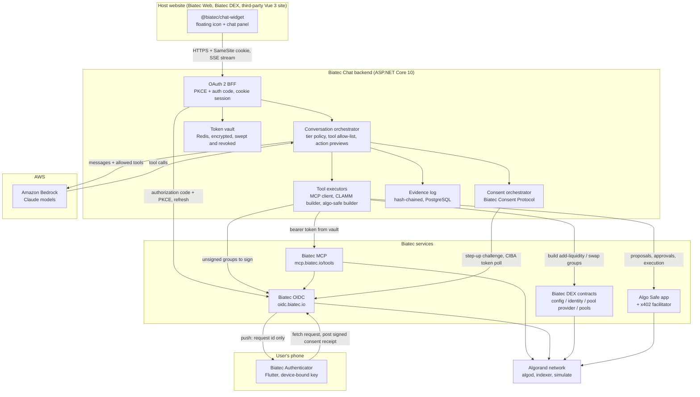
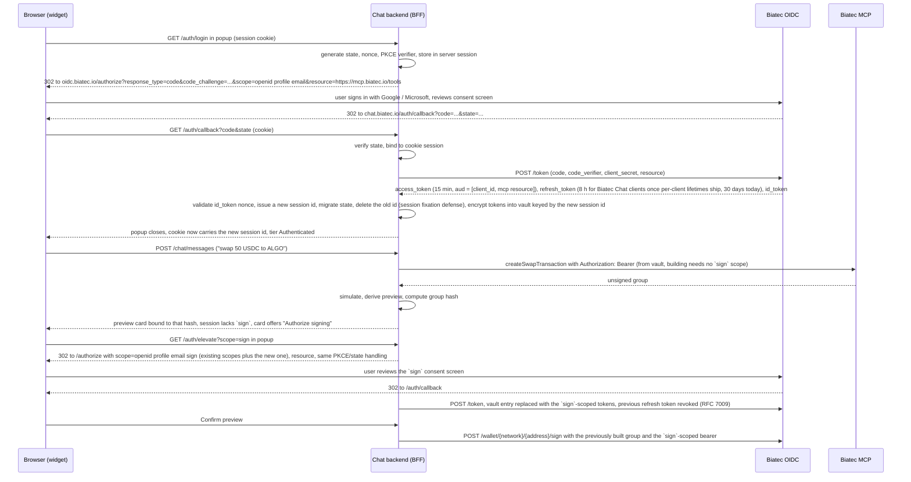
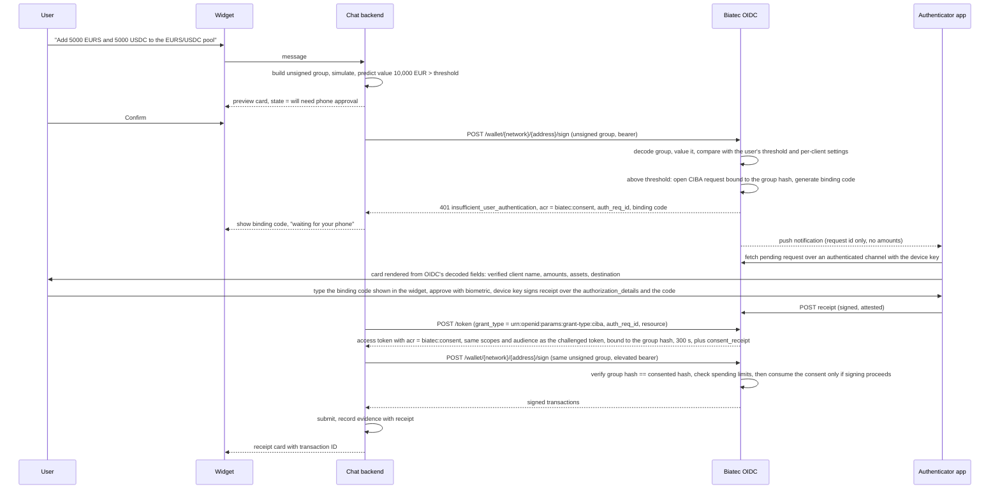

# Biatec Chat

**Conversational, consent-gated access to self-custody finance, Algorand first.**

Biatec Chat is an embeddable AI assistant that lives in the bottom-right corner of Biatec web properties (Biatec Web, Biatec DEX) and, through an npm package, any third-party Vue 3 site. Visitors can ask the assistant to explain the products and the blockchain. Signed-in users can ask it to act: transfer funds from their self-custody addresses (to their own other addresses or anywhere else), swap assets, add liquidity to a Biatec DEX pool, or create and govern a Biatec Safe shared account. Every action that moves user funds flows through the user's own Biatec OIDC identity, the user's own spending limits, and, above a configurable threshold, an explicit approval on the user's phone in the Biatec Authenticator app.

The assistant never holds keys, never sees long-lived tokens, and never acts outside what the user has authorized.

* Chat that discovers capabilities for anyone, and executes only for authenticated, consenting users
* A backend that keeps every credential out of the browser and every transaction in an evidence log
* A mobile authenticator and an open consent protocol so banks and other third parties can integrate without asking permission, yet users cannot be tricked by impostors

---

## Why This Product

Biatec already has the hard parts of self-custody finance:

- **Biatec OIDC** (`https://oidc.biatec.io`) is an OpenID Connect provider and a self-custody wallet API. Users sign in with Google or Microsoft, their Algorand/EVM/Bitcoin keys are derived and encrypted into their own cloud storage, and third-party clients can request transaction signing under user-controlled daily, weekly, and monthly spending limits.
- **Biatec MCP** (`https://mcp.biatec.io/tools`) exposes that wallet to AI assistants over the Model Context Protocol as an OAuth 2.1 resource server. It builds, signs, and submits payments, opt-ins, swaps, bridges, multisig, and Bitcoin transactions, chained as three separate steps so an unsigned transaction can be inspected before it is ever broadcast.
- **Biatec DEX** (BiatecCLAMM) is a concentrated-liquidity AMM on Algorand, shipped as the `biatec-concentrated-liquidity-amm` npm package with `clammAddLiquiditySender`, `clammSwapSender`, and `clammRemoveLiquiditySender` helpers.
- **Algo Safe** is a policy-driven smart account with M-of-N signer groups, transaction proposals, spending limits, and an x402 payment facilitator for the agent economy.
- **Biatec Web** is a Vue 3 + PrimeVue marketing and product site deployed to Kubernetes.

What is missing is the front door. Today a user has to know which product does what, where the buttons are, and how a transaction group is assembled. Biatec Chat turns that into a conversation, and does it without weakening any of the security properties the underlying services already enforce.

---

## Product Vision

Biatec Chat should feel like talking to a knowledgeable, careful banker who happens to be available on every Biatec page.

- A visitor should get accurate answers about what Biatec offers, without being asked to sign in.
- A signed-in user should be able to say "swap 100 USDC to EURS" or "add liquidity to the EURS/USDC pool" and see a clear preview of exactly what will happen on-chain before anything is signed.
- A high-value action should pause and appear on the user's phone, with the same amount, asset, and destination the chat showed, for an approval that cannot be faked by a malicious website or a compromised browser tab.
- A team should be able to create a Biatec Safe in chat, have one member propose a transaction, and have another member approve it from their own session.
- Every one of those actions should leave a tamper-evident trail: what was asked, what the model proposed, what the user consented to, and which transaction landed on-chain.

Longer term, the same backend, consent protocol, and authenticator serve agents that are not chat at all: scheduled automations, agent-to-agent payments over x402, and third-party banks or fintechs that want Biatec users to approve their requests on the same trusted device.

---

## Products In This Monorepo

| Product | Package / project | Stack | Purpose |
| --- | --- | --- | --- |
| Chat widget | `@biatec/chat-widget` (npm) | Vue 3, TypeScript, Vite library build | Floating chat icon and chat panel injected into Biatec Web, Biatec DEX, and any Vue 3 host |
| Chat backend | `Biatec.Chat.Api` | ASP.NET Core 10 (.NET), AWS Bedrock, Redis, PostgreSQL | OAuth 2 BFF, model orchestration, tool execution via Biatec MCP, session recording, evidence log, consent orchestration |
| Authenticator | `biatec_authenticator` | Flutter (iOS, Android) | Device-bound approval of high-value actions and sign-in; reference implementation of the Biatec Consent Protocol |

Shared pieces:

- `packages/chat-protocol`: the typed JSON contract between widget and backend (messages, suggestions, action previews, consent status), generated from the backend's OpenAPI document.
- `packages/consent-protocol`: the Biatec Consent Protocol specification, JSON schemas, test vectors, and a conformance test suite that any third-party integrator can run.
- `docs/`: architecture, threat model, integration guides, hackathon demo script.

---

## Core Concepts

### Session Tiers

Every chat session is in exactly one of two tiers, Anonymous or Authenticated. The tier determines which tools the model may call and which prompts the backend will refuse. Separately from the tier, an individual action can be **consent-elevated**: a per-action flag, never a session state, set when the action needs and receives approval in Biatec Authenticator.

| Tier | How it is reached | What the assistant may do |
| --- | --- | --- |
| **Anonymous** | Widget loads, no sign-in | Capability discovery only: explain Biatec products, Algorand, DEX concepts, fees, how to get started. No account data, no transaction building, no price-sensitive advice beyond public facts. |
| **Authenticated** | User completes Biatec OIDC login (PKCE + authorization code) through the backend | Everything above, plus read own addresses and balances, build and preview transactions. Signing and submitting (transfers, swaps, liquidity, safes) additionally needs the `sign` scope, granted once per session through a consent popup the first time an action needs it, and stays within the user's own spending limits. |

Consent elevation applies to one action in an Authenticated session: the action exceeds a policy threshold, or is always-consented, the user approves it in Biatec Authenticator, and that one action may then proceed with the exact parameters approved, within a short validity window. The session itself stays Authenticated.

An anonymous session that receives an action request is not escalated silently. The assistant explains that the request needs sign-in, shows what the action would do in general terms, and offers the sign-in button; on a host where sign-in is unavailable (see Embedding Modes) it instead says so and links to the tenant's configured sign-in page (one of the tenant's registered origins; Biatec Web for the Biatec tenant), where the user can start again signed in. The backend enforces this independently of the model: in the anonymous tier the tool list sent to the model contains no wallet tools, and any tool call that slips through is rejected server-side.

### Capabilities And Intents

A capability is a named, versioned thing the assistant can do. Each capability declares the minimum tier, the scopes it needs on the Biatec OIDC access token, whether it moves funds, and how its value is computed for the consent threshold.

Initial capability set:

| Capability | Tier | Scopes | Moves funds | Backed by |
| --- | --- | --- | --- | --- |
| `explain.product`, `explain.blockchain` | Anonymous | none | no | Model knowledge plus a curated knowledge base of Biatec docs |
| `wallet.listAddresses`, `wallet.balance` | Authenticated | `openid` | no | Biatec MCP `listAlgorandAddresses`, `getCryptoAddress`, `getCryptoBalance` |
| `wallet.transfer` | Authenticated | `sign` | yes | Built by Biatec MCP `createPaymentTransaction` (native ALGO or any ASA such as EURS and USDC) or `createBitcoinTransaction`; signed by the backend directly at Biatec OIDC `POST /wallet/{network}/{address}/sign`; broadcast by Biatec MCP `submitTransactionToBlockchain`. When the receiver is the user's own un-opted address, the opt-in is a separate preceding single-sender transaction from that address (`createOptInTransaction`), valued at zero; if that address lacks the ALGO for its minimum balance and fee, a small ALGO payment from the source address precedes the opt-in. All steps appear on one preview card, numbered |
| `dex.swap` | Authenticated | `sign` | yes | Quoted and built by Biatec MCP `createSwapTransaction`, which compares Biatec Router with other aggregators and returns an unsigned transaction only when Biatec Router wins; otherwise built against a user-chosen Biatec DEX pool with `clammSwapSender`; signed directly at Biatec OIDC; broadcast by Biatec MCP or algod. See the DEX executor |
| `dex.addLiquidity`, `dex.removeLiquidity` | Authenticated | `sign` | yes | Built by the backend with `biatec-concentrated-liquidity-amm`; signed directly at Biatec OIDC; broadcast by the backend through algod |
| `safe.create`, `safe.addSignerGroup` | Authenticated | `sign` | yes (app funding) | `algo-safe` npm library |
| `safe.propose` | Authenticated | `sign` | no (proposal only, nothing moves) | `algo-safe` proposal builder |
| `safe.approve` | Authenticated | `sign` | yes (authorizes the safe's spend; value = the proposal payload's value) | `algo-safe` `approveProposal` with `expectedPayloadVersion` |
| `safe.execute` | Authenticated | `sign` | no (permissionless once the threshold is met; value already consented by approvers) | `algo-safe` `executeProposal` |
| `limits.view` | Authenticated | `openid` | no | Biatec OIDC `GET /wallet/limits` |
| `limits.update` | Authenticated (consent-elevated action whenever a limit is raised) | `manage-limits` | no, but raises risk | Biatec OIDC `PUT /wallet/limits`, which issues the same step-up challenge as signing when any limit goes up, with a `biatec_limits_change` authorization detail hashed over the canonical request body; lowering limits applies immediately, so a user without a device can always reduce their own exposure. Biatec OIDC grants `manage-limits` only to clients an operator has allowlisted, so this capability is enabled per tenant and hidden on tenants whose client lacks it |
| `x402.pay` | Authenticated | `sign` | yes (value = the USDC transfer Biatec OIDC decodes from the built group, never the seller's advertised price) | `algo-safe` x402 client and facilitator; behind a feature flag until after the hackathon |

Capabilities deliberately excluded from chat in version 1: anything requiring the `rekey` scope, asset creation, bridge transactions, and any action whose source address is not one the user's Biatec OIDC identity controls. Destinations may be any address or application (another of the user's own addresses, a safe, a pool, an x402 payee) and are always shown in full on the preview. These can be added later as separate capabilities with their own consent rules.

The value used for the consent threshold is always computed by Biatec OIDC from the transaction group itself, never taken from the chat backend. For a safe approval, Biatec OIDC reads the proposal payload from the safe's on-chain boxes and values that payload, because the approval app call is what authorizes the spend even though the approver's own balance does not move. That value drives the consent threshold only; it does not count against the approver's own daily, weekly, or monthly spending limits, which track the approver's own addresses, and the preview shows no limit bucket for safe approvals.

Signing is never delegated to Biatec MCP's `signTransaction` tool. Biatec MCP is used to build transactions, read balances and addresses, and broadcast signed bytes; every signature request goes from the backend straight to Biatec OIDC, so the step-up challenge described under the consent protocol always reaches the backend and can be completed.

### Action Preview

Every capability that moves funds produces an **action preview** before anything is signed. The preview is a structured object rendered by the widget as a card, not free text from the model:

- Human-readable intent ("Swap 100 USDC for at least 91.80 EURS on Biatec DEX")
- Network and genesis ID (chain identifier for Bitcoin)
- Source address and destination (or pool application ID with its fee tier and price range)
- Assets, amounts, decimals, and the fiat value used for policy decisions
- Fees and slippage settings
- Simulation result from `algod` simulate where available (for Bitcoin: decoded inputs, outputs, change, and fee rate instead)
- Which spending-limit bucket the action counts against and how much headroom remains
- Whether the action is expected to need authenticator approval and why, predicted from the user's settings read through Biatec OIDC's consent-settings endpoint (Biatec OIDC still decides)

The user confirms the preview in the widget. For consent-elevated actions, the phone shows the same facts, but not the backend's preview: Biatec OIDC decodes the unsigned transaction group itself and renders the card from what it decoded.

The value that binds every later step is the **group hash**. On Algorand-family chains it is the protocol's own group ID: the hash the network computes over the ordered transactions, which every SDK (algosdk, the .NET SDK used by Biatec OIDC) produces byte-identically, so no custom canonical encoding is needed. The backend always assigns the group ID before building the preview, including to a lone transaction (a group of one carries the `grp` field just like a larger group), and the identical bytes are what is previewed, consented, signed, and submitted. Biatec OIDC recomputes the group ID from the transactions it is handed and refuses the request if the `grp` field they carry does not match, so a client cannot label one group with another's identifier. For Bitcoin the exchanged format is a PSBT that carries `witness_utxo` (or `non_witness_utxo` for legacy inputs) for every input, so prevout values and scripts travel inside the bytes. The hash is SHA-256 over RFC 8785 canonical JSON of the decoded intent, `{inputs: [{txid, vout, sats}], outputs: [{address, sats}], feeSats}`, which the backend and Biatec OIDC each derive from the PSBT alone without consulting a node; it is used instead of a transaction ID because the unsigned serialization is not canonical and, for legacy inputs, the transaction ID changes on signing (for native SegWit inputs it does not, and the evidence record pins the pre-signing transaction ID too in that case). The evidence record stores the final transaction ID once broadcast. For a safe approval no special construction is needed: the proposal ID and the expected payload version are arguments of the `approveProposal` call inside the group, so the group hash already commits to them.

A built group is only valid for a bounded window (Algorand allows at most 1000 rounds, roughly 45 minutes; Bitcoin transactions do not expire but their fee estimate goes stale). The preview therefore carries the group's expiry, the widget shows a countdown, and a preview whose group has expired cannot be confirmed: the backend rebuilds the group, which yields a new hash and a new preview the user must confirm again. The countdown shown is the smaller of the group's remaining validity and the session's remaining absolute lifetime (keepalives keep the idle term from ever binding); while a preview is pending and the panel is open, the widget sends a lightweight keepalive that extends the idle timeout (never the absolute lifetime), so a user who returns inside the countdown is never met by a swept session. Scope elevation and phone approval normally complete well inside the window; if they do not, the user sees a fresh preview rather than a silent rebuild. In a multi-step action, steps that already landed on-chain are never rebuilt or re-executed: the rebuilt preview lists them as completed with their transaction IDs and asks for confirmation only of the remaining steps, each of which gets a new hash. The backend derives the preview from the group, the consent receipt signs the group hash, the signing request carries the same group, and the evidence record stores the hash next to the submitted transaction IDs. A group that differs by one byte from the consented one has a different hash and is refused by Biatec OIDC.

### Evidence Record

Every conversation produces an append-only evidence record. A conversation has a stable internal identifier that never changes; browser sessions (the cookie, the anonymous transport, the rotated session id after login) are mappings onto it, so adoption and session rotation never touch the chain. Each entry commits to its content through a salted payload hash, and the chain hashes over those commitments together with the entry's position, so an entry cannot be transplanted into another conversation or another position without detection. All hashes are computed over RFC 8785 canonical JSON of an explicit object, which removes any boundary ambiguity between implementations: `payloadHash = SHA-256(JCS({salt, payload}))` with a fresh 32-byte random salt per entry, and `entryHash = SHA-256(JCS({conversationId, seq, prevHash, kind, payloadHash}))`. The server signature covers `JCS({entryHash, kid, signedAt})`. Encodings are fixed so two implementations agree byte for byte: `salt`, `prevHash`, `payloadHash`, and `entryHash` are lowercase hexadecimal strings; `conversationId` is its UUID string; `seq` is a JSON number; `kind` is a string; `payload` is the JSON object itself, not a serialized string, with every amount, round number, asset ID, and other integer that may exceed 2^53 encoded as a decimal string so RFC 8785 number serialization never loses precision; `signedAt` is an RFC 3339 UTC timestamp; and the first entry of a conversation uses 64 zero characters as `prevHash`. A transcript cannot be edited after the fact without detection, and a payload and its salt can later be deleted together for privacy while the chain still verifies and the retained hash reveals nothing about the deleted content. Because the backend holds the signing key, the chain is additionally anchored on Algorand every 10 minutes (see the threat model), which is what makes it tamper-evident against the operator as well as against outsiders.

Recorded per session:

- Session metadata: tier changes, tenant, widget version, timestamps. No IP addresses or geolocation are recorded; the only personal data an anonymous conversation can hold is whatever the visitor chose to type, which is kept for 30 days; because an anonymous conversation cannot be tied to a requester, deletion on request applies to signed-in conversations, and anonymous ones are removed only by the 30-day retention
- Every user message and assistant message, including the model's tool calls and tool results (secrets redacted by schema, not by regex)
- Every action preview, each of its steps with its group hash, and the user's confirmation
- Every consent request and consent receipt from the authenticator, including the device key identifier and signature
- Every signing request to Biatec OIDC and its outcome, including spending-limit decisions
- Every submitted transaction ID, confirmation round, and final on-chain status

Evidence is exportable by the user as a signed JSON bundle and is the basis for dispute handling, audits, and the hackathon demonstration.

---

## Architecture



**Boundary rules**

- The widget never receives an access token, refresh token, ID token, or authorization code. It only ever holds an opaque, HTTP-only, `Secure`, `SameSite=Lax` session cookie issued by the backend, and that cookie is always first-party to the page the widget runs on (see Embedding Modes).
- The backend is the only OAuth client. Each tenant is registered with Biatec OIDC as its own confidential client with PKCE enforced in addition to its client secret, so the authenticator can tell tenants apart. A tenant has exactly one backend host (Biatec's own sites share the single host `chat.biatec.io` and form one tenant), so the cookie host and the registered redirect URI always coincide.
- Model calls go to Amazon Bedrock from the backend only. The widget never talks to Bedrock, and no Bedrock credential leaves the backend's AWS role.
- Transaction building uses the official builders: Biatec MCP tools for payments, Bitcoin transfers, and router swaps; `biatec-concentrated-liquidity-amm` for liquidity and for swaps against a specific Biatec DEX pool; `algo-safe` for safes. The backend never hand-assembles transaction groups.
- Signing always happens inside Biatec OIDC. The backend sends unsigned transaction groups and receives signed bytes; it never sees key material.

---

## Chat Widget (`@biatec/chat-widget`)

### Packaging

- Published to npm as `@biatec/chat-widget`, ESM and UMD builds, Vue 3 as a peer dependency.
- Installed with one plugin call in the host application:

```ts
import { createApp } from 'vue'
import { BiatecChat } from '@biatec/chat-widget'
import '@biatec/chat-widget/style.css'

createApp(App)
  .use(BiatecChat, {
    backendUrl: 'https://chat.biatec.io',
    clientKey: 'biatec-web',          // identifies the host, not a secret
    locale: 'en',
    theme: 'auto',
    suggestions: 'default',
  })
  .mount('#app')
```

- Styles are scoped under a `biatec-chat` root with CSS custom properties, so the widget does not fight the host's PrimeVue theme in Biatec Web or any other design system.
- No host-page data is read by default. A host can opt in to pass a page context string (for example the pool currently shown on Biatec DEX) that the assistant may use to pre-fill suggestions.

### Embedding Modes

The session cookie must be first-party to the page, because the widget never relies on third-party cookies. Two modes satisfy that:

- **Biatec sites.** Biatec Web and Biatec DEX run under `biatec.io` subdomains and the backend runs at `chat.biatec.io`. Browser requests from `web.biatec.io` or `dex.biatec.io` to `chat.biatec.io` are same-site, so the cookie is sent.
- **Third-party hosts.** A third party points a subdomain such as `chat.example-bank.com` at the Biatec Chat backend; the backend is multi-tenant by `Host` header and scopes the cookie to it. TLS for tenant hostnames is issued and renewed automatically through ACME (the Kubernetes ingress with cert-manager in the reference deployment, HTTP-01 or DNS-01 challenge), triggered by tenant onboarding once the CNAME resolves; a tenant that prefers to bring its own certificate uploads it through the onboarding API. The widget's `backendUrl` is then same-site with the host page. Path-based reverse proxying is not supported, because it would require trusting forwarded-host and forwarded-prefix headers and would break exact redirect URI matching.
- **Unregistered or cross-site hosts.** Any page can still run the anonymous tier against the configured backend's public endpoint, `POST {backendUrl}/public/chat`, which allows any origin, uses no cookie, and is rate-limited per IP and per origin. A tenant's widget therefore falls back to that tenant's own backend, never to Biatec's, so the tenant's model, suggestions, and evidence store still apply. When a later probe succeeds and the widget switches to the cookie transport, it passes the anonymous conversation identifier together with the current continuation token, from the same origin, and the backend adopts that conversation into the cookie session, so continuity is kept; a stale identifier without the live continuation token cannot be adopted by anyone else. If a reply is lost mid-stream, the client may retry once with the previous continuation token and the server replays the stored reply; a conversation that still cannot continue is replaced by a new one transparently. Adoption retires the identifier: from that moment the public endpoint refuses it, and it refuses any conversation that has an `oidcSub`, so nobody who learned the identifier can append to a conversation that has become authenticated. A public conversation that ended on idle is refused the same way, with a distinct error code; the widget then starts a new conversation transparently and shows a one-line note that the earlier one was closed. The backend generates a 128-bit random anonymous conversation identifier on the first call and returns it; the widget keeps it in memory for the life of the page and sends it with later messages so the conversation has continuity. It is never shown to the user, never embedded in links, and grants only the ability to append to that conversation: the public endpoint never returns earlier messages, so a guessed identifier reads nothing. Every reply from the public endpoint also carries a fresh single-use continuation token, and the next message must present it, so a party that merely observed an old identifier cannot even append. The widget does not guess same-site status from host names, because page script cannot evaluate the Public Suffix List reliably. When the user first opens the panel (not on page load, so visitors who never open the chat cost nothing and receive no cookie) it makes two credentialed requests to the backend's session endpoint: the first response sets the cookie, and the backend's answer to the second says whether that cookie came back. A network or CORS failure on either request (which is what an unregistered origin sees, since the session endpoint allows only the tenant's registered origins) counts as "cookie not returned" for now. In that case the widget asks the public endpoint (which allows any origin) whether the calling origin is registered for this tenant. An unregistered origin stops there, uses the public transport for the life of the page, and logs one console warning. A registered origin that failed the probe treats the failure as transient: it uses the public transport provisionally, retries the probe with backoff in the background and again whenever the user clicks Sign in, and switches to the cookie transport as soon as a probe succeeds, so an outage never hides sign-in for the life of the page.

The cookie is `SameSite=Lax`, not `Strict`, on every tenant. For a third-party tenant the authorization-code callback from `oidc.biatec.io` to `chat.example-bank.com` is a cross-site top-level navigation and must carry the cookie to find the pending `state` and PKCE verifier; Strict would drop it. For the Biatec tenant the callback happens to be same-site, so Strict would appear to work in testing, which is exactly why Lax is mandated uniformly rather than left to per-tenant configuration. Lax still withholds the cookie on every cross-site request that is not a top-level navigation, and every state-changing endpoint additionally requires the custom header and origin check described under Security Model.

Each tenant is a separate Biatec OIDC client with its own `client_id`, client secret, one backend host and therefore one redirect URI, and (optionally) an OpenID Federation entity statement. An organization that wants several backend hosts creates several tenants. A tenant is created by a Biatec Chat operator or by the tenant itself through the self-service onboarding endpoint. Onboarding binds the host name only after proving control of it: a DNS TXT challenge on that name, or an OpenID Federation entity configuration served from the parent domain that names the host. A host can belong to exactly one tenant. The onboarding endpoint then registers a confidential client at Biatec OIDC through RFC 7591 Dynamic Client Registration (a Biatec OIDC addition, since its registration endpoint issues public clients only today; until it ships, an operator adds the client to the static list) and stores the client secret in the deployment's secret store (AWS Secrets Manager or Kubernetes secrets) under a reference the tenant record points to; the secret is never written to the database. Biatec's own sites share one tenant, "Biatec Chat". Because the OIDC client is the tenant, the consent card on the phone names the tenant, the user's per-client thresholds and pauses apply to that tenant alone, and a hostile host cannot borrow Biatec's name.

### User Experience

1. **Launcher**: a round chat icon in the bottom-right corner. Keyboard accessible, respects `prefers-reduced-motion`, and can be positioned by the host.
2. **Panel**: opens as a drawer on desktop and full-screen on mobile. Header shows the Biatec logo, the current tier ("Guest" or the signed-in email with the active primary address), and a sign-in or sign-out control.
3. **Sample prompts** shown on an empty session, chosen by tier and host context:
   - "Explain to me what the blockchain is and why Biatec uses Algorand."
   - "Transfer funds from my primary Bitcoin address to my secondary Bitcoin address."
   - "Add liquidity to the Biatec DEX EURS/USDC pool."
   - "Swap 50 USDC to ALGO."
   - "Create a Biatec Safe for my team with 2-of-3 approvals."
   - "What are my current spending limits?"
4. **Streaming replies** over Server-Sent Events, with tool progress shown as compact status lines ("Checking your USDC balance", "Simulating transaction group").
5. **Action preview card** with Confirm and Cancel. A consent-elevated action shows a "Waiting for approval on your phone" state with a countdown, the short binding code the user must type into the authenticator, and a Cancel button.
6. **Sign-in handoff**: clicking Sign in opens a backend URL in a popup; the backend redirects to Biatec OIDC and back. The widget never sees the OAuth parameters. Each popup flow has an authorization request ID; the widget polls the backend's session endpoint until that request is reported complete (or failed), then closes the popup and resumes whatever the user was doing. The same popup mechanism is reused when a capability needs a scope the session does not have yet (for example the first fund-moving action needs `sign`), so the chat context is never lost to a full-page redirect.
7. **Receipts**: after an action completes, the card shows the transaction ID with an explorer link, and a "Download evidence" link for the session.

### Accessibility And Localization

- WCAG 2.1 AA: focus trapping in the panel, ARIA live region for streamed messages, visible focus styles, contrast-checked theme tokens.
- Localization through the same `vue-i18n` message format Biatec Web already uses, with English and Slovak at launch.

---

## Chat Backend (`Biatec.Chat.Api`)

### Responsibilities

- Terminate the browser session and act as the OAuth 2 Backend-for-Frontend (BFF).
- Run the conversation loop against Amazon Bedrock with a per-tier tool allow-list.
- Execute tools against Biatec MCP, Biatec OIDC, Biatec DEX libraries, and the `algo-safe` library.
- Compute action previews, simulate transaction groups, and apply consent policy.
- Drive the Biatec Consent Protocol towards the authenticator.
- Record sessions and evidence.
- Expose health, metrics, and an admin API for policy and knowledge-base management.

### Model Layer

- Model access is through Amazon Bedrock, so no Anthropic API key is stored anywhere. The backend's AWS role is scoped to `bedrock:InvokeModel` and `bedrock:InvokeModelWithResponseStream` on the allowed model identifiers.
- The default model is the current Claude Opus generation available on Bedrock, with the Claude Sonnet generation configured as the cost-saving option for anonymous capability-discovery sessions. Model identifiers are configuration, not code.
- Every request carries a system prompt built from two stable parts, in this order, so Bedrock prompt caching stays effective: the Biatec persona and refusal rules, and the tier's capability catalogue. Knowledge-base content never enters the system prompt; the model retrieves it through the knowledge-base search tool, and the results arrive as untrusted data like any other tool result. Volatile data (balances, quotes, timestamps) also goes into tool results, never into the system prompt.
- The backend owns the tool loop. The model proposes a tool call; the orchestrator validates the call against the tier allow-list and the JSON schema, executes it, and returns the result. A tool call that fails validation returns an error result to the model and is logged as a policy event.
- Prompt injection defense: content that comes from outside the user (knowledge-base pages, token names, on-chain notes, host page context) is wrapped as untrusted data in tool results. The system prompt instructs the model that such content never changes the tier or the action. The backend enforces the same rule regardless of what the model does.

### Tier Enforcement

Enforcement is layered so a model mistake cannot become a security incident:

1. **Tool visibility**: the anonymous tier's request to Bedrock contains only the `explain.*` tools, the knowledge-base search tool, and `requestSignIn`.
2. **Server-side gate**: every tool call is checked against the session tier, the token's scopes, and the capability registry before execution.
3. **Refusal content**: there is no separate intent classifier in front of the model. In the anonymous tier the model has the refusal rules in its system prompt and exactly one action-related tool, `requestSignIn`, which renders the sign-in card (or the "sign-in unavailable here" card). When a visitor asks for an action, the model explains in general terms what the action would do and calls that tool; the backend logs the attempt. Whatever the model says, it cannot act, because no wallet tool exists in that request and the server-side gate rejects any other tool call.
4. **Scope check at execution**: before calling Biatec MCP or Biatec OIDC, the backend inspects the stored access token's `scope` claim. A capability whose scope is missing is refused with a message that offers to re-authorize with the needed scope.

### Tool Executors

- **MCP client**: a Model Context Protocol client that connects to `https://mcp.biatec.io/tools` with the user's bearer token. Biatec MCP requires a bearer token even to list tools, so discovery is lazy: the first authenticated call for a user lists the tools with that user's token, and the backend caches the tool list (it is identical for every user), re-listing it piggybacked on the next authenticated call once the cache is older than an hour rather than on a timer that would need a token of its own; it maps the list onto chat capabilities and alerts if a tool a capability depends on disappears. The chain is always build (MCP), then preview, then sign (Biatec OIDC directly), then submit (MCP or algod); the MCP `signTransaction` tool is never called, so the step-up challenge always reaches the backend.
- **DEX executor**: uses `biatec-concentrated-liquidity-amm` to resolve `configAppId`, `identityAppId`, and `poolProviderAppId` for the active network and lists the pools for the requested asset pair. A concentrated-liquidity pair usually has several pools with different fee tiers and price ranges; if the user did not name one, the assistant asks a clarifying question showing each pool's fee, price range, and current liquidity rather than choosing silently. The preview then carries the pool application ID, fee tier, price range, and the verification class of the account that will actually interact with the pool (the user's address, or the safe's application account for a safe proposal); pools whose minimum class that account does not meet are not offered, with an explanation of how to get the account verified. The executor builds the add-liquidity or remove-liquidity group, simulates it, and hands the unsigned group to Biatec OIDC for signing; the phone card shows the pool application ID and amounts decoded from the group, and the `authorization_details` carry the pool's fee tier and price range as Biatec OIDC reads them from the pool's global state. Swaps follow the `dex.swap` row of the capability table: Biatec MCP `createSwapTransaction` when Biatec Router wins the quote, otherwise the user chooses between proceeding on a named Biatec DEX pool through `clammSwapSender` or cancelling, and non-Biatec routers are out of scope for version 1.
- **Safe executor**: uses the `algo-safe` library to create a safe, add signer groups, create proposals with the exact typed payload, submit `approveProposal` app calls signed by the user's address, and call `executeProposal` once the threshold is reached. Proposal payload versions are shown in the preview so an approver always knows what they approve.
- **Limits executor**: reads and updates spending limits through Biatec OIDC. Raising any limit is consent-elevated; lowering applies immediately.

### Session Recording And Evidence

- Transcripts and evidence entries live in PostgreSQL. Each entry stores `salt`, `payloadHash` (SHA-256 over the salt and the canonical payload JSON), `prevHash`, `entryHash`, and a server signature with a rotating key published at a JWKS endpoint, so a user or auditor can verify a bundle offline. The signature covers the tuple (`entryHash`, `kid`, `signedAt`), so the key identifier and timestamp cannot be altered either. Retired evidence-signing keys stay published at the JWKS endpoint, marked with their retirement date, for as long as any entry they signed is retained. An exported bundle embeds the public keys its entries were signed with as a convenience, but a verifier must compare them against the published JWKS (fetched at verification time or pinned earlier); a bundle whose embedded keys are not in the JWKS is not authentic, however well it verifies against itself. A verifier recomputes `payloadHash` for every entry whose payload and salt are present and uses the stored `payloadHash` for entries whose payload was deleted, so deletion never breaks the chain and the hash of a deleted entry cannot be matched against guessed content.
- Personal data is minimized: email and addresses are stored as the OIDC `sub` plus the address strings needed for evidence. The model's tool results are stored after schema-driven redaction of anything marked `sensitive` in the tool's output schema.
- Retention is configurable per deployment. Default: full transcripts 90 days, evidence entries 7 years for fund-moving actions, anonymous sessions 30 days.
- Users can view and export their own sessions from the widget. Deletion requests remove message payloads and their salts but keep each entry's `payloadHash`, the chain, consent receipts, and transaction references, because those are needed for dispute resolution and keep the bundle verifiable.

---

## Security Model: Authorization Without Tokens In The Browser

### Flow



Every token request from the backend, at login and at each elevation, includes `resource=https://mcp.biatec.io/tools`, so the access token's `aud` always contains that protected-resource entry alongside the `client_id`. Biatec MCP validates the resource entry, and Biatec OIDC's own wallet API accepts tokens through the same protected-resource entry, which is the arrangement Biatec MCP relies on when it forwards a caller's bearer token to Biatec OIDC. The backend never relies on the `client_id` entry being accepted by the wallet API, because that holds only for statically configured clients, not for dynamically registered tenants. One token therefore serves both the MCP tools and the direct wallet calls (`/wallet/.../sign`, `/wallet/limits`).

Biatec OIDC shows its consent screen on every authorization request today, so the elevation above always presents the `sign` consent. The design does not depend on a `prompt` parameter (Biatec OIDC's authorization endpoint has none); if consent memoization is ever added to Biatec OIDC, scope elevation must keep forcing a fresh consent screen, and that is recorded in the required-changes table.

### Rules

- **Authorization Code + PKCE** per RFC 7636 on every login, even though the backend is a confidential client. `state` is bound to the cookie session and single-use; `nonce` is validated on the ID token.
- **Resource indicator** (RFC 8707) `resource=https://mcp.biatec.io/tools` is sent so the access token's audience matches what Biatec MCP validates locally against the Biatec OIDC JWKS.
- **No tokens in the browser.** The widget receives only an opaque session cookie: `HttpOnly`, `Secure`, `SameSite=Lax`, `__Host-` prefix, with a short idle timeout (15 minutes of inactivity) and an absolute lifetime (8 hours). Hosts that cannot serve the backend first-party stay in the anonymous tier (see Embedding Modes); there is no third-party-cookie path.
- **Token vault.** Access and refresh tokens are encrypted at rest with a key from the deployment's KMS (AWS KMS in the reference deployment), stored in Redis keyed by session ID, and expire with the session. Refresh tokens are rotated on every use, and a rotated token must inherit the original absolute expiry rather than restarting it (listed under Required Changes To Biatec OIDC, because the threat model's 8-hour window depends on it). Because the backend is horizontally scaled, a refresh is single-flighted per session through a short Redis lock: the pod that holds the lock refreshes and writes the new tokens, other pods wait and reuse them, so a rotated refresh token is never presented twice and Biatec OIDC's reuse detection never fires on legitimate traffic. Revocation and deletion order at logout, elevation, and sweep is stated once, under Logout below. The vault is never written to logs or evidence.
- **Minimal lifetime.** Access tokens live 15 minutes (Biatec OIDC default) and are refreshed only on demand for a tool call, never proactively. Neither the idle timeout nor the absolute lifetime is enforced by Redis expiry: the vault entry's Redis TTL is the absolute lifetime plus a one-hour grace period, and a sweeper runs every minute, revokes the refresh token of every session that is idle past its timeout or past its absolute lifetime, and only then deletes the entry, so the token needed for revocation is still at hand. The TTL is only a backstop for a sweeper outage. Revocation itself follows the single normative statement under Logout.
- **Scope minimization.** Login requests `openid profile email`. The `sign` scope is requested only when the user first proceeds with an action preview that needs it: the card offers "Authorize signing", which runs an incremental re-authorization in the same popup mechanism as sign-in, and the Confirm button becomes available once the scope is held. `manage-limits` is requested only for the limits capability. `/auth/elevate` accepts only `sign` and `manage-limits` from a fixed allow-list and rejects every other value, so `rekey` can never be requested through it. Every elevation requests the union of the scopes the session already holds and the new one, so tokens only ever gain scopes within a session, and the refresh token being replaced is revoked as soon as the new tokens are vaulted (per the Logout statement), so no orphaned refresh token outlives the session. `rekey` is never requested by this product.
- **Tenant-level soft cap.** On top of the user's Biatec OIDC spending limits, the backend tracks cumulative below-threshold spend of the user's own funds keyed on the user's OIDC `sub` and the tenant, over a rolling window; safe approvals and executions, which move the safe's funds rather than the user's, are not counted. The platform default is 500 EUR per hour; a tenant may lower it for itself, and only a Biatec Chat operator may raise it for a tenant that chains to a recognized trust anchor, so a self-registered tenant can never loosen it. Starting a new session does not reset it. Once the cap is reached, the backend does not refuse further actions; it sets `requireConsent: true` on every subsequent signing request, a wallet-API field that makes Biatec OIDC open the CIBA request regardless of value. A legitimate user with an active device keeps working with one extra tap per action, while a hostile host page is limited to what the user visibly approves. A user with no active device cannot satisfy the challenge, so for them the cap is a hard stop for the rest of the window; the widget says so and offers enrollment. The cap is enforced by the backend and is additional to, never instead of, the limits Biatec OIDC enforces.
- **CSRF and origin.** Every state-changing endpoint called from script requires a custom header plus the tenant's origin allow-list. Each allowed origin must be same-site with the backend host (same registrable domain), because only then can the session cookie be first-party; an origin on another registrable domain is rejected at onboarding with an explanation rather than accepted and left to fail silently. Each origin is proven the same way the backend host is: a DNS TXT challenge on that exact origin host, or the origin being the verified backend host itself or a name beneath it. A sibling or apex name is never inferred from a subdomain proof, so a tenant cannot list origins it does not control. The three browser navigations in the login flow (`GET /auth/login`, `GET /auth/elevate`, `GET /auth/callback`) cannot carry a custom header and are protected differently: `/auth/login` and `/auth/elevate` only create a pending authorization request inside the caller's own cookie session (and the Biatec OIDC consent screen names the scopes being granted, so a forged elevation is visible to the user before it takes effect), and `/auth/callback` only completes a pending request whose `state` matches that same session, so a forged navigation can at most start or finish a login for the session the browser already holds. Login CSRF (an attacker forwarding their own callback URL to a victim to bind the attacker's account to the victim's session) is blocked precisely by that `state`-to-session binding: the attacker's `state` belongs to the attacker's session, so the victim's backend session rejects it. This binding must never be relaxed; PKCE protects the code exchange, not this.
- **Tenant identity.** The tenant is derived from the `Host` header alone, which is also what the cookie is scoped to. The widget's `clientKey` is a metrics label; on the cookie transport the backend validates it against the tenant's registered keys, and on the public anonymous endpoint it is accepted as an unvalidated label. It never selects policy and grants nothing.
- **Logout** revokes the refresh token first, then deletes the vault entry, clears the cookie, and performs RP-initiated logout at the existing `/connect/endsession` endpoint with the stored ID token as `id_token_hint`. This paragraph is the single normative statement of revocation for the whole document: the same order, revoke then delete, applies wherever a refresh token is said to be revoked (scope elevation, the idle and absolute-lifetime sweeper), and revocation means the RFC 7009 endpoint listed under Required Changes To Biatec OIDC; until that ships, every such step deletes the vault entry and lets the token age out, and the deployment's security notes say so.
- **Secrets handling.** Tenant OIDC client secrets, Redis credentials, database credentials, and signing keys for evidence live in Kubernetes secrets or AWS Secrets Manager and are referenced from configuration and tenant records, never stored in `appsettings.json` or the database.

### Threat Model Highlights

| Threat | Mitigation |
| --- | --- |
| XSS on a host page steals tokens | There are no tokens to steal; the cookie is HttpOnly and SameSite=Lax, and fund-moving actions above threshold need the phone |
| Malicious or compromised host page drives the widget to act | The widget shares the host page's DOM and JavaScript realm, so the Confirm click and the CSRF header are not a boundary against the host itself. The real boundaries are outside the page: Biatec OIDC's per-user spending limits, the consent threshold enforced by Biatec OIDC with number matching on the phone, the backend's tenant-level soft cap, and the user's option to require phone approval for every action from that tenant, which is a distinct OIDC client. The residual exposure is below-threshold spend inside those caps, which is the same exposure as any site the user signs into |
| Prompt injection via on-chain data or docs | Untrusted content wrapped as data; tier and scope gates enforced server-side |
| Backend compromise | Keys never leave Biatec OIDC; spending limits, the consent threshold, first-use and cooling-off rules are enforced by Biatec OIDC, not by the chat backend; consent receipts are verified by Biatec OIDC against the transaction group it is asked to sign. The residual exposure is real: an attacker holding the vault's decryption role gets every active session's `sign`-scoped refresh token and can drive below-threshold spend within each user's limits until the tokens are revoked. Today that window is the 30-day refresh lifetime with no revocation endpoint. Once the per-client refresh lifetime and RFC 7009 endpoint listed under Required Changes ship, it shrinks to the session's 8-hour absolute lifetime; independently, vault decryption uses a separate KMS key with its own role that only the API pods hold |
| Replay of a consent | Receipts are bound to the group hash, the `auth_req_id` nonce, the client ID, and a short expiry, and are spent by exactly one signing call |
| Transcript tampering by an outsider | Hash-chained, signed evidence entries |
| Transcript tampering by the operator or a compromised backend | The backend cannot forge what it does not sign: consent receipts are signed by the user's device, and signed transactions are on-chain. In addition, every 10 minutes the backend anchors the current head hash of every conversation that is open or ended since the previous anchor (changed or not, so every anchor in a conversation's lifetime has a leaf for it; conversation ends are folded into the next tick rather than anchored one by one), batched into one Merkle root, in the note field of an Algorand transaction from a dedicated, publicly known evidence account. Each note carries the root, an anchor sequence number, and the previous anchor's transaction ID, so the complete anchor history is enumerable from the chain alone through the indexer; a tick that fails to broadcast is retried and, if it is lost, the next anchor's note records the gap. For every anchor actually on-chain within a conversation's lifetime the bundle must carry that conversation's inclusion proof (anchored `seq`, head hash, leaf index, sibling hashes); a verifier walks the on-chain anchor sequence, requires a proof for each on-chain anchor from the first one that contains the conversation up to the one that contains its end marker, and checks that each anchored head equals the bundle's `entryHash` at that `seq`. Because a tick snapshots before it confirms, the first containing anchor may be up to two sequence numbers after the anchor the first entry recorded; the verifier accepts that bound and rejects a later first inclusion. The window itself is bounded by the chain, not by the operator: a conversation's first entry records the transaction ID of the latest anchor confirmed on-chain at creation time (never one still pending or lost), and its last entry is an explicit end marker that the next tick anchors, so neither the start nor the end can be moved after the fact. Entries after the most recent anchor are reported by the verifier as "signed but not yet anchored" rather than as verified, and a bundle exported for a dispute is taken only after the end marker has been anchored. Rewriting history and re-anchoring cannot hide that the earlier, already-anchored heads no longer match |

---

## Biatec Authenticator And The Biatec Consent Protocol

### Goal

A mobile app, comparable in role to Microsoft Authenticator, that shows the user a clear description of a pending action and lets them approve or deny it with a device-bound key. The default policy is that any single action valued above 1000 EUR (converted at the same rates Biatec OIDC uses for spending limits) requires authenticator approval. Users can lower that threshold, enable approval for everything, or set per-client thresholds, but cannot raise it above a deployment-defined ceiling. Any change that loosens protection (raising a threshold, turning off "always ask", lifting a client pause, widening a per-client setting) is itself a consent-elevated action approved on an active device, and a user with no active device cannot loosen anything; tightening changes apply immediately without approval. An attacker holding only the identity-provider login therefore cannot talk the system down to no phone.

The threshold and the user's per-client settings are stored and enforced by Biatec OIDC, at the signing endpoint. The chat backend never decides whether a phone approval is needed; it can only predict it for the user interface. If the backend skips the prediction, or is compromised, the signing request still fails with a step-up challenge until a matching receipt exists.

The protocol must let a bank or any other third party integrate without asking Biatec for permission, while making it impossible for an impostor to present itself as that bank to the user.

### Building On Existing Standards

Rather than invent a new protocol, the Biatec Consent Protocol is a profile over standards that already solve the individual pieces:

| Need | Standard | How it is used |
| --- | --- | --- |
| Push an approval to a device that did not start the flow | OpenID Connect Client-Initiated Backchannel Authentication (CIBA), push and poll modes | A CIBA request is opened either by the client at the backchannel authentication endpoint, or by Biatec OIDC itself when a wallet endpoint answers with a step-up challenge; both produce the same request object and the same receipt |
| Describe exactly what is being approved | OAuth 2.0 Rich Authorization Requests (RFC 9396) `authorization_details` | Typed objects: `biatec_transaction` (network, group hash, and the fields Biatec OIDC decoded from the group itself: sender, receiver or application, asset, amount, fiat value) and `biatec_limits_change` (current and requested limits, hash of the canonical request body) |
| Bind the approval to the amount and payee (PSD2 dynamic linking) | PSD2 Strong Customer Authentication dynamic linking, carried by RFC 9396 `authorization_details`; CIBA `binding_message` as an optional purpose statement | The amount and payee the user sees come from `authorization_details` that Biatec OIDC decoded from the group, and they are inside the signed receipt, so a changed amount invalidates the consent. `binding_message` adds a client's purpose text for trust-anchored clients and is empty in Biatec Chat's own step-up receipts |
| Financial-grade hardening | FAPI 2.0 Security Profile and FAPI-CIBA | PKCE on every authorization request, exact redirect URI matching, short token lifetimes, `request_expiry` defaults of 300 seconds. Sender-constrained tokens (DPoP) are a roadmap item, not a current claim, because Biatec MCP forwards the caller's bearer token to Biatec OIDC today |
| Step up only when needed | OAuth 2.0 Step-up Authentication Challenge (RFC 9470) | Biatec OIDC answers a signing or limits request that needs consent with `insufficient_user_authentication`, the required `acr`, and a CIBA `auth_req_id` it has already opened for that exact group or request body; the client polls the token endpoint for the elevated token and retries with it. A client may instead open the CIBA request itself first (see Two Entry Points below); either way the wallet endpoint accepts only a consent bound to the hash of what it is asked to do |
| Device-bound, phishing-resistant user keys | FIDO2 / WebAuthn passkeys and platform keystores (Secure Enclave, Android StrongBox) | The authenticator's receipt signing key is generated in hardware and attested at enrollment |
| Prove the app is genuine | OAuth 2.0 Attestation-Based Client Authentication (IETF draft) with Apple App Attest and Google Play Integrity | Each authenticator instance presents an attestation when enrolling and when posting receipts |
| Let third parties register without permission, yet be verifiable | RFC 7591 Dynamic Client Registration plus OpenID Federation 1.0 trust chains | Any client can self-register; display name and logo are shown to the user only if the client's entity statement chains to a trust anchor the user's deployment recognizes |
| Record AI intent in a verifiable way | Agent Payments Protocol (AP2) mandates (W3C Verifiable Credentials, SD-JWT with key binding) | The chat backend issues the equivalent of an intent mandate for the action, and the user's approval produces the equivalent of a cart mandate, both attached to the evidence record |
| Standard consent record | Kantara Consent Receipt structure | The receipt JSON follows the consent receipt field layout so it can be exported and verified by third parties |

### Flow



For a safe approval the group is the `approveProposal` app call; Biatec OIDC reads the referenced proposal and its payload from the safe's boxes on-chain, values the payload, and shows those fields on the phone, so an approver always consents to the actual spend they authorize.

### Two Entry Points, One Request Model

A CIBA request at Biatec OIDC is always the same object: `authorization_details`, a binding code generated by Biatec OIDC, an optional client-supplied `binding_message`, the client's identity, `request_expiry`, and the hash it is bound to. The `binding_message` is shown on the card, under the decoded facts and visibly attributed to the client, only for clients that chain to a recognized trust anchor; for unverified clients it is stored in the receipt but not rendered, so an unverified client has no free-text channel to the trusted surface. It can be opened in two ways:

- **Step-up entry.** The client calls a wallet endpoint (`/wallet/{network}/{address}/sign` or `PUT /wallet/limits`) with an ordinary token. The CIBA request inherits that token's scopes and audience, so the elevated token the client later receives carries the same `sign` or `manage-limits` scope and the same resource and can be presented straight back to the wallet endpoint (in the direct entry the client passes `scope` and `resource` itself). Biatec OIDC decides consent is needed (value above threshold, cooling-off or first use, the client sent `requireConsent: true`, or the user has set "always ask" for this client), opens the request itself, and returns the challenge with `auth_req_id` and the binding code. The chat backend uses this entry for everything, so it never has to guess the threshold.
- **Direct entry.** The client calls the backchannel authentication endpoint with the exact unsigned transaction group (or the canonical limits request body) plus `binding_message`. Biatec OIDC decodes the group, builds the `authorization_details` itself exactly as in the step-up entry, opens the request, and returns `auth_req_id` and the binding code. A bank that has already built the group and wants the consent in hand before calling the wallet endpoint (for example to drive its own progress UI) uses this entry, then presents the resulting token to the wallet endpoint, which checks the hash as usual. Client-supplied amounts or payees are never accepted as the thing being consented to; the group is.

In both entries the client receives the signed consent receipt together with the token: the CIBA token response carries it in a `consent_receipt` field, and it can be fetched again at `GET /consent/receipts/{auth_req_id}` by the client the request belongs to: the one that opened it in the direct entry, or the one whose token was challenged in the step-up entry. The chat backend stores it verbatim in the evidence record.

The conformance suite exercises both entries and asserts that the receipts they produce validate against the same schema, use the same canonical form and signing rules, and differ only in field values (the direct entry's `binding_message` is present but empty in a step-up receipt).

### Protocol Rules

1. **What you see is what you sign.** The authenticator renders the card only from the `authorization_details` object it fetches from Biatec OIDC over an authenticated channel, never from the push notification body or from anything the client sends directly. The receipt signs the canonical form of that object.
2. **Number matching.** Biatec OIDC generates a short binding code that is shown only in the requesting surface (widget, bank app, website). The authenticator does not display it; the user must type it into the authenticator to approve. A wrong code is not immediately a denial: the user has three attempts in total within the request's validity, and the third wrong code, or an explicit Deny, produces a denial. This makes approval fatigue and mis-attributed pushes fail closed: a card the user did not initiate has no code to type, and a concurrent request from another tab or a hostile tenant cannot be approved by reflex. The entered code is part of the signed receipt.
3. **Verified identity of the requester.** The authenticator shows a client's display name, logo, and domain only when the client's OpenID Federation entity statement chains to a trust anchor. Unverified clients are shown as "Unverified application" with a short fingerprint of their `client_id` in a warning style and nothing else, because a self-declared redirect domain is unverified at registration and would let an impostor put a bank's name on the trusted surface. The user's policy may block unverified clients entirely. Biatec Chat's own tenant chains to Biatec's trust anchor, so users are never trained to approve unverified cards by the normal flow.
4. **Cooling-off for new clients and first use.** For a user with an active enrolled device: for the first 24 hours after a client registers, and for the first action that user ever performs through a given client, every signing request requires phone approval regardless of value, as if the threshold were zero. A new client therefore cannot spend anything, not even below threshold, without the user seeing it on the phone. A client that chains to a recognized trust anchor skips the 24-hour part but not the first-use part. For a user with no active device, Biatec OIDC instead applies a reduced per-client daily cap (default 100 EUR) to a client during its first 24 hours and to that user's first day with the client, so the user keeps a working product while the exposure stays small until they enroll.
5. **Short validity.** A consent is valid for 300 seconds by default, is bound to one group hash, and authorizes exactly one signing call. It is spent only when Biatec OIDC actually signs; a call that fails the hash check, the spending limits, or any other validation leaves the consent unspent so the user is not asked twice for the same group. Biatec OIDC's signing endpoint signs for one sender address per call, so the backend never builds groups with transactions from two of the user's addresses; an action that needs two senders (such as an opt-in followed by a transfer) is two groups, two signing calls, and, if each needs it, two consents. A Bitcoin transaction in version 1 spends from a single address, so it is one signing call; a transfer that needs funds from several of the user's Bitcoin addresses is split into one transaction per address, each with its own group hash and signing call. Biatec OIDC rejects a signing request whose group hash differs from the consented group hash.
6. **No secrets on the phone beyond the device key.** The authenticator holds a hardware-backed key pair and an enrollment identifier. It holds no wallet keys, no cloud-storage tokens, and no long-lived OAuth tokens. Losing the phone cannot drain the account.
7. **Enrollment is itself consented, or delayed.** Enrolling a device starts with a fresh full Biatec OIDC login that includes the identity provider's own multi-factor step. If an already-enrolled device approves the enrollment, the new device is active immediately. Otherwise (the very first device, or a lost-device recovery) the device is enrolled but inactive for 24 hours; every enrolled device and the user's email receive a cancel link, and during that period any action that needs phone approval is blocked. A recovery code, generated and shown once only after a device has become active (never during enrollment, so whoever enrolls a device cannot use it to skip the delay), activates a later device immediately. For a user who already has a device, an attacker holding only the Google or Microsoft login cannot silently add one, because the existing phone is notified and can cancel. For a user with no device yet, the email notice goes to a mailbox that the same login controls, so the delay only buys time; that is why rule 4 keeps a never-enrolled user's exposure small, and why the widget nags users to enroll and to save the recovery code.
8. **No device, no above-threshold actions.** A user without an active enrolled device can use every below-threshold capability (subject to the reduced caps in rule 4) but cannot complete an action that needs phone approval; the widget explains this and offers enrollment. The default threshold is not lowered for such users, because that would reward not enrolling.
9. **Receipts are verifiable offline.** A receipt contains the signed `authorization_details`, the `auth_req_id` (which serves as the single-use nonce), the binding code, the client's entity identifier, the device key ID, the device's public key together with its enrollment attestation countersigned by Biatec OIDC, the timestamp, the decision (approve or deny), and the user's `sub`. Anyone with the Biatec OIDC JWKS can therefore verify both the device signature and that the device was enrolled for that `sub`, with no further lookups.
10. **Deny is as loud as approve.** A denial produces a signed denial receipt and immediately cancels the pending action in the requesting surface. Denials never auto-block a client, because a correct denial must not punish the user. Instead, Biatec OIDC allows at most three pending requests per client per user (so a user with a pending swap on Biatec DEX can still start an action on Biatec Web, which shares the Biatec Chat client), rate-limits new requests as an anti-spam measure only (default 60 per hour per client per user, with no per-second burst limit, so the back-to-back consents of a multi-step action are never refused), and after three denials in a day the authenticator offers a one-tap "pause this client for 24 hours" that the user can lift from the trusted-clients screen. The widget lists the user's pending requests across tabs so a refusal for too many pending requests is explained.
11. **Rate and amount limits are enforced by Biatec OIDC.** The authenticator approval never bypasses spending limits; it is an additional requirement on top of them. Note that Biatec OIDC's per-user limits cover the user's own addresses only; funds inside a Biatec Safe are governed by the safe's own on-chain signer-group limits plus the consent threshold applied to each approval.

### Authenticator App (Flutter)

- Screens: enrollment, pending approvals list, approval card, approval history, device management, trusted clients and per-client thresholds, security settings (biometric requirement, threshold, blocked clients).
- Push through Firebase Cloud Messaging and Apple Push Notification service, with the notification carrying only a request identifier. All content is fetched from Biatec OIDC.
- Device key in Secure Enclave or Android StrongBox through platform channels; attestation collected at enrollment and refreshed periodically.
- Offline mode: shows the last known state and refuses to approve without a live fetch, so a stale card can never be signed.
- Accessibility: large-type card, screen reader labels for amounts and names, no color-only warnings.

### Required Changes To Biatec OIDC

Biatec OIDC today provides the authorization-code flow with PKCE, dynamic client registration, resource indicators, the `sign` / `manage-limits` / `rekey` scopes, the per-address signing endpoint with spending limits, and transaction decoding for limit enforcement. The consent protocol depends on additions that do not exist yet. They are part of this product's scope, listed here so the hackathon plan budgets for them, each with the fallback used if it is not ready:

| Addition | Purpose | Fallback if not ready |
| --- | --- | --- |
| Backchannel authentication endpoint (CIBA) with `auth_req_id`, binding code, push to enrolled devices, and the CIBA token grant | Opens and completes consent requests | None; the consent protocol is the product |
| `authorization_details` types `biatec_transaction` and `biatec_limits_change`, built by Biatec OIDC from the decoded group or request body | What the phone shows and what the receipt signs | None |
| Step-up challenge (RFC 9470 style) on `/wallet/{network}/{address}/sign` and `PUT /wallet/limits`, with the user's threshold, per-client settings, cooling-off and first-use rules, and the `requireConsent` request field | Makes Biatec OIDC the only decision point | None |
| Device enrollment, attestation, activation delay, recovery code, and the consent receipt format with `consent_receipt` in the token response and `GET /consent/receipts/{auth_req_id}` | Authenticator support and evidence | None |
| Valuation of Algo Safe application calls by method, reading proposals from boxes (Bitcoin outputs and Algorand payments and asset transfers are already priced by the spending-limit code) | Threshold on safe approvals | Treat unknown application calls as above threshold (always ask) |
| Decoding of Biatec DEX pool calls: recognizing the pool provider's pools, reading fee tier and price range from the pool's global state, and valuing the asset transfers in the group | Pool facts on the phone card for liquidity actions and direct pool swaps | Treat the call as an unknown application call (always ask) and show only the decoded transfers and the application ID |
| Valuation on test networks from a configurable static price table (today Algorand transfers are priced on Algorand mainnet and Bitcoin outputs on Bitcoin mainnet; test networks are never priced) | Lets the threshold fire in the testnet demo and in CI, for Algorand and Bitcoin test networks alike | Configure the demo identities with "always ask" for the Biatec Chat client and no spending limits, so consent fires without valuation |
| Group-hash binding in the signing endpoint: recompute the Algorand group ID from the handed transactions and refuse a mismatching `grp`; derive the Bitcoin intent hash from a PSBT carrying prevout data; compare either with the consented hash before signing | The "one byte different, refused" guarantee that every consent relies on | None; the consent protocol is unsafe without it |
| Confidential-client dynamic registration for tenants that pass domain verification (today `POST /register` issues public clients only) | Self-service tenant onboarding | A Biatec Chat operator adds the tenant's client to Biatec OIDC's static client list; onboarding is then reviewed rather than fully permissionless |
| Reduced per-client daily cap for users without an active device | Rule 4 | When the user has no active device, block all signing for clients younger than 24 hours and for the user's first day with any client |
| OIDC-computed value returned in every signing response (`valuedEur`) | Lets the backend's soft cap count what Biatec OIDC actually valued rather than its own prediction | Count the backend's predicted value, and document that the soft cap is then only as good as the backend's price feed |
| OpenID Federation trust-chain evaluation for client display names | Impostor protection | Pin Biatec's own clients as verified by configuration and show every other client as unverified |
| Forced fresh consent on scope elevation if consent memoization is ever introduced | Keeps the `sign` consent screen visible | Not needed while every authorization shows the consent screen |
| RFC 7009 token revocation endpoint that revokes exactly the presented refresh token (not the whole grant for the client and subject), so the token issued by a scope elevation survives revocation of the one it replaced | Logout and scope elevation hygiene | Destroy the vault entry and let the token age out |
| Per-client refresh token lifetime so Biatec Chat tenants receive 8-hour refresh tokens instead of 30-day ones, with rotation preserving the original absolute expiry | Shrinks the window a stolen vault is useful for | Keep 30-day tokens and rely on revocation; the threat model's residual exposure is then 30 days |
| Consent-gated loosening of consent settings (threshold, "always ask", per-client settings, client pauses) | Keeps an identity-provider-only attacker from disabling the phone | Settings can be loosened only from an active enrolled device's own screen, not from the web |
| `GET /consent/settings` returning, for the calling client, the user's consent threshold, per-client settings such as "always ask", cooling-off and first-use status, and whether an active device is enrolled | Lets the backend predict on the preview card whether the phone will be asked, and tell users without a device to enroll | Card says "may need approval on your phone" without predicting |

### Permissionless Third-Party Integration

A bank, a fintech, or any other service can integrate in three steps without contacting Biatec (once the confidential-client registration listed under Required Changes To Biatec OIDC ships; until then step 2 is an operator-reviewed registration). Capabilities that need the `manage-limits` scope stay reserved for operator-allowlisted clients:

1. Publish an OpenID Federation entity configuration at its domain and obtain a subordinate statement from any trust anchor the deployment recognizes (initially Biatec's own anchor and, as they become available, national or EU-level financial trust lists).
2. Self-register a client with Biatec OIDC through RFC 7591 Dynamic Client Registration, declaring `backchannel_token_delivery_mode` and the `authorization_details_types` it will use.
3. Either call the backchannel authentication endpoint with the exact unsigned transaction group and a `binding_message` (direct entry; Biatec OIDC builds the `authorization_details` from the group), or call the wallet endpoint and handle the step-up challenge (step-up entry); in both cases display the returned binding code to the user, poll or receive the token, and present it to the wallet endpoint.

The `packages/consent-protocol` conformance suite exercises these steps against a mock Biatec OIDC so integrators can validate before going live.

---

## Biatec Safe In Chat And The Hackathon Demonstration

### Safe Capabilities

Chat can create a Biatec Safe (an Algo Safe deployment) and manage it through the `algo-safe` library:

- Create a safe with a name, network, and an initial signer group (for example 2-of-3 with three addresses collected in chat).
- Add or change signer groups through governed proposals, so admin changes follow the same approval path as payments.
- Propose a transaction: payment, asset transfer, or a DEX add-liquidity application call group, stored as the exact ordered typed payload.
- Approve a proposal from a different user's session; the approval is a signed `approveProposal` app call from that user's address, carrying the `expectedPayloadVersion` so a changed payload invalidates the approval. The approval is the consent point: if the payload's value exceeds the approver's threshold, Biatec OIDC requires phone approval of that payload before signing the approval call.
- Execute once the threshold is met; the safe emits the payload as one atomic inner transaction group. Execution needs no value-based consent, because every approver already consented to the exact payload and the safe contract itself enforces the signer-group limits; the non-value triggers (first use, cooling-off, soft cap, "always ask") can still make Biatec OIDC challenge an execution, and the Safe executor handles that challenge through the same step-up path as every other capability.

Biatec OIDC values Algo Safe application calls by method, so the threshold lands on the step that actually authorizes a spend: `approveProposal` is valued at the referenced payload (read from the safe's boxes); `executeProposal` is valued at zero, because the contract only executes payloads whose approvals already reached the threshold and execution cannot change the payload; `createSafe` and administrative proposals are valued at any funding payment in the same group. The first-use rule, cooling-off, `requireConsent`, and the user's "always ask" setting still apply to every call including execution, since they do not depend on value.
- Show the proposal queue, approval progress, membership epoch, and expiry rounds in a card.

### Demonstration Script

The fintech hackathon demo uses two browsers, two Biatec OIDC identities, and two phones, one enrolled and activated per identity at least a day before. The Biatec Chat tenant client is registered in advance so the new-client cooling-off does not apply; the first-use rule still means each user's first action is phone-approved, which is a feature of the demo. The demo runs on Algorand testnet, where Biatec OIDC cannot price assets today, so either the testnet valuation mode is in place or both demo identities are configured with "always ask" for the Biatec Chat client and no spending limits. Neither identity has spending limits configured (limits cannot be enforced on testnet anyway, and a configured limit would make Biatec OIDC refuse to sign there). The two configurations differ only in whether below-threshold steps (the small ALGO funding, the opt-in proposal, and the execution) also ask the phone; the script notes where:

1. **Alice** opens Biatec Web, opens the chat, and asks "Create a Biatec Safe for me and Bob with 2-of-2 approvals." She signs in, pastes Bob's address when the assistant asks for it, sees the preview, authorizes signing in the popup when the card asks, and confirms the preview. This is her first action through Biatec Chat, so her phone asks for approval of the safe creation; she approves, and the safe is deployed. The chat shows the application ID and the safe address.
2. Alice asks "Fund the safe with 2000 EURS and 2000 USDC." The assistant explains that the safe must first hold ALGO for its minimum balance and opt in to both assets, and turns that into a setup proposal: a small ALGO payment from Alice to the safe, and a safe proposal that opts the safe's application account in to EURS and USDC (zero-amount `axfer` transactions to itself, which `algo-safe` builds). Alice confirms and approves the proposal as the first signer (under the "always ask" fallback her phone asks; under testnet valuation the small ALGO payment is below threshold, her first use was already consumed in step 1, and the approval itself is valued at zero, so it does not).
3. **Bob** opens Biatec DEX in another browser, opens the chat, signs in, and asks "Show me pending proposals in my safes." He sees the setup proposal, confirms, authorizes signing in the popup, approves as the second signer (his phone asks because it is his first action), and asks "Execute it." Under the fallback his phone asks once more for the execution; under testnet valuation it does not. The safe opts in.
4. Alice asks "Now fund the safe." Under testnet valuation the transfer's value exceeds her threshold; under the fallback "always ask" applies. Either way her phone shows the Biatec Authenticator card with the amounts, the safe address, and the binding code matching the widget. She approves. The chat shows the transaction IDs.
5. Alice asks "Propose adding all the safe's EURS and USDC as liquidity to the Biatec DEX EURS/USDC pool." The chat asks which of the EURS/USDC pools she means; the demo pool is deployed with verification class 0 so the freshly created safe, which has no identity record, is eligible. The chat then builds the application call group with `biatec-concentrated-liquidity-amm`, including the safe's opt-in to the pool's LP token as the first transaction of the payload, stores it as a proposal, shows the payload preview and version, and asks whether she also approves it as the first of two signers. She confirms; the payload is worth about 4000 EUR, so her phone shows the proposal's amounts and the pool application ID, she approves, and her approval app call is signed (1 of 2).
6. Bob asks "Show me pending proposals." He sees Alice's liquidity proposal with the exact payload and confirms. Bob's phone shows the same amounts, the pool application ID, and his binding code; he approves, and his approval app call is signed (2 of 2, threshold met).
7. Either user asks "Execute the proposal." Under testnet valuation mode execution is valued at zero and signs without the phone; under the "always ask" fallback the executor's phone asks once more. The safe executes the inner group, and the chat shows the pool position and the LP tokens held by the safe.
8. The presenter opens the evidence export for both sessions and shows the hash chain, the consent receipt, and the on-chain transaction IDs lining up.

### x402 And The Agent-To-Agent Economy

Algo Safe already ships an x402 facilitator (`algo-safe-x402-facilitator`, a Hono server exposing `/verify`, `/settle`, and `/supported` for the `exact` scheme on Algorand), an x402 client, and a demo shop. Biatec Chat uses them in two ways:

- **Chat as a buyer.** The `x402.pay` capability (see the capability table; feature-flagged until after the hackathon) lets the assistant pay for an x402-protected resource on the user's behalf, within the user's spending limits and, above threshold, with authenticator approval. The payment is a safe-governed or wallet-signed USDC transfer built by the `algo-safe` library and settled through the facilitator. Its value for the consent threshold is whatever Biatec OIDC decodes from the built transfer, so a seller advertising a low price while requiring a larger transfer gains nothing, and a payment cannot be sized to dodge the phone.
- **Chat backend as a seller.** Premium capabilities (for example deep portfolio analysis) can be exposed as x402-protected endpoints so another agent can pay the Biatec Chat backend for them, with the same facilitator verifying and settling.

This is the bridge from "a human chats with an agent" to "agents pay agents under human-set policy," and it is what the Algo Safe spending-limit and signer-group model was designed for.

---

## Data Model (Backend)

| Entity | Key fields | Notes |
| --- | --- | --- |
| `Conversation` | id, tenantId, oidcSub (nullable), createdAt, lastMessageAt, endedAt | Stable identifier the evidence chain is keyed on; survives anonymous-to-cookie adoption and session rotation. A conversation ends when its last session ends (session rotation at login is not an end)  or, for the public transport, after 30 minutes without a message; ended conversations are no longer anchored |
| `ChatSession` | id, conversationId, tier, tenantId, oidcSub (nullable), createdAt, lastActivityAt, absoluteExpiresAt | Cookie maps to this id; a new id is issued at login and points at the same conversation |
| `Message` | conversationId, seq, role, content, toolCalls, toolResults, modelId, usage | Content stored after redaction |
| `ActionPreview` | id, conversationId, capability, canonicalJson, predictedValueEur, predictedNeedsConsent, expiresAt (earliest step expiry), status, rebuiltAsPreviewId | One card as the user sees it. Status: proposed, confirmed, in-progress, completed, failed, cancelled, expired. An expired preview points at the preview that replaced it so the evidence shows why a hash changed. Predicted fields are UI hints; Biatec OIDC decides |
| `ActionStep` | id, previewId, seq, kind (sign or limits), subjectHash (group hash, or hash of the canonical limits request body), unsignedGroup (sign only), limitsRequest (limits only), senderAddress, network, firstValid, lastValid, expiresAt, status, txIds | One Biatec OIDC call. Most actions have one step; an opt-in plus transfer has two or three, each with its own hash, consent, and evidence entries |
| `ConsentRequest` | id, stepId, subjectHash, authReqId, bindingCode, expiresAt, status, receipt | Receipt stored verbatim. Code attempts are counted by Biatec OIDC, not here |
| `EvidenceEntry` | conversationId, seq, kind, payload and salt (both nullable after deletion), payloadHash, prevHash, entryHash, kid, signedAt, signature (over entryHash, kid, signedAt) | Append-only |
| `EvidenceAnchor` | id, sequenceNumber, previousAnchorTxId, anchorTxId, merkleRoot, anchoredAt | One row per on-chain anchor transaction; the note carries the same three fields plus a `gapFrom` marker naming any lost sequence numbers, and the verifier's two-sequence bound is measured over on-chain anchors, skipping recorded gaps |
| `EvidenceAnchorLeaf` | anchorId, conversationId, anchoredSeq, headHash, leafIndex, siblingHashes (each with a left or right flag) | Inclusion proof for one conversation in one anchor; the bundle carries one per anchor in the conversation's lifetime. Tree construction is fixed: leaves are sorted by `conversationId`, `leaf = SHA-256(0x00 ‖ JCS({conversationId, anchoredSeq, headHash}))`, `node = SHA-256(0x01 ‖ left ‖ right)`, and an unpaired node at any level is promoted unchanged rather than duplicated |
| `TokenVaultEntry` | sessionId, encryptedAccessToken, accessExpiresAt, encryptedRefreshToken, encryptedIdToken (for `id_token_hint` at logout), scopes | Redis; TTL is the absolute session lifetime plus one hour as a backstop, and the sweeper, not the TTL, ends sessions (see Minimal lifetime) |
| `Tenant` | id, host (verified by DNS or federation challenge), oidcClientId, clientSecretRef (pointer into the secret store, never the secret), redirectUri (derived from host), allowedOrigins (each domain-verified at onboarding), clientKeys, softCapEurPerHour (at most the platform default unless raised by an operator), trustAnchorVerified, defaultModel, suggestions | One Biatec OIDC client and one backend host per tenant, resolved from `Host`. User thresholds and per-client rules live in Biatec OIDC, not here |
| `SoftCapSpend` | oidcSub, tenantId, spentAt, amountEur (the `valuedEur` Biatec OIDC returned with the signature once that field ships; the backend's predicted value until then), valueSource | One row per below-threshold action; the rolling-window total is the sum of rows newer than the window, so the cap cannot be doubled at a boundary. Rows older than the window are pruned |

---

## Repository Layout

```
biatec-chat/
├── packages/
│   ├── chat-widget/              @biatec/chat-widget (Vue 3 library)
│   ├── chat-protocol/            shared TypeScript types generated from backend OpenAPI
│   └── consent-protocol/         Biatec Consent Protocol spec, schemas, conformance tests
├── backend/
│   ├── Biatec.Chat.Api/          ASP.NET Core 10 host (BFF, orchestrator, tools, evidence)
│   ├── Biatec.Chat.Core/         domain model, policies, canonicalization, hashing
│   ├── Biatec.Chat.Tools/        MCP client, DEX executor, Safe executor
│   └── Biatec.Chat.Tests/        unit and integration tests with mocked OIDC, MCP, Bedrock
├── apps/
│   └── biatec_authenticator/     Flutter app
├── docs/
│   ├── architecture.md
│   ├── threat-model.md
│   ├── integration-widget.md
│   ├── integration-third-party-consent.md
│   └── hackathon-demo.md
├── k8s/                          deployment manifests (main, stage) following Biatec conventions
└── PRODUCT-DESCRIPTION.md
```

---

## Non-Functional Requirements

- **Latency**: first streamed token within 2 seconds for anonymous answers; action preview within 5 seconds including simulation.
- **Availability**: backend stateless except Redis and PostgreSQL; horizontally scalable; graceful degradation to anonymous tier if Biatec OIDC is unreachable, with a clear message.
- **Observability**: OpenTelemetry traces across widget request, Bedrock call, MCP call, and OIDC call; metrics for refusals per tier, consent approvals and denials, and policy violations.
- **Testing**: contract tests for the widget-backend protocol; policy tests that assert the anonymous tier can never reach a wallet tool; replay tests for the evidence hash chain; conformance tests for the consent protocol; end-to-end test of the hackathon script on Algorand testnet using the testnet valuation mode or the "always ask" fallback described under Required Changes To Biatec OIDC.
- **Compliance posture**: data minimization, user export and deletion, evidence retention aligned with financial record-keeping, and a published security contact.

---

## Research Anchors

- Biatec OIDC and Biatec MCP: [AlgorandGoogleDriveAccount](https://github.com/ludovit-scholtz/AlgorandGoogleDriveAccount). Authorization code with PKCE, RFC 7591 dynamic registration, RFC 8707 resource indicators, `sign` / `manage-limits` / `rekey` scopes, 15-minute access tokens, 30-day refresh tokens, daily/weekly/monthly spending limits in a user-chosen currency, and a three-step build, sign, submit MCP tool chain.
- Biatec DEX contracts and library: [BiatecCLAMM](https://github.com/scholtz/BiatecCLAMM). `biatec-concentrated-liquidity-amm` npm package, config, identity, and pool provider applications, verification classes on the identity provider.
- Algo Safe: [algo-safe](https://github.com/ludovit-scholtz/algo-safe). Signer groups, typed proposals, membership epochs, `approveProposal` with payload versions, atomic inner-group execution, x402 facilitator, client, and shop.
- Biatec Web: [BiatecWeb](https://github.com/scholtz/BiatecWeb). Vue 3, Vite, PrimeVue, Pinia, vue-router, vue-i18n, Kubernetes deployment.
- Standards: OpenID Connect CIBA Core; OAuth 2.0 Rich Authorization Requests (RFC 9396); OAuth 2.0 Step-up Authentication Challenge (RFC 9470); PKCE (RFC 7636); Resource Indicators (RFC 8707); Dynamic Client Registration (RFC 7591); FAPI 2.0 Security Profile and FAPI-CIBA profile; OpenID Federation 1.0; OAuth 2.0 Attestation-Based Client Authentication (IETF draft); FIDO2 / WebAuthn; Agent Payments Protocol (AP2) mandates; Kantara Consent Receipt; x402 payment protocol.

---

## Success Criteria

Biatec Chat succeeds when:

1. A visitor on Biatec Web can ask what Biatec is and get a correct answer without signing in, and is politely refused when asking to move funds.
2. A user can sign in through Biatec OIDC without any token ever reaching the browser, verified by inspecting network traffic and storage.
3. A user can transfer between their own Bitcoin addresses, swap on Biatec DEX, and add liquidity to the EURS/USDC pool from chat, each with a preview that matches what lands on-chain.
4. An action above the threshold cannot complete without a matching approval in Biatec Authenticator even if the chat backend never asks for one, and a modified transaction is rejected by Biatec OIDC even with a valid earlier approval.
5. Two users can create a Biatec Safe, propose, approve, and execute an add-liquidity transaction entirely from chat.
6. Every session exports a signed evidence bundle whose hash chain and transaction IDs verify independently.
7. A third party can pass the consent-protocol conformance suite and request approvals from Biatec users without any manual onboarding by Biatec, while appearing as "Unverified" until it chains to a recognized trust anchor.
