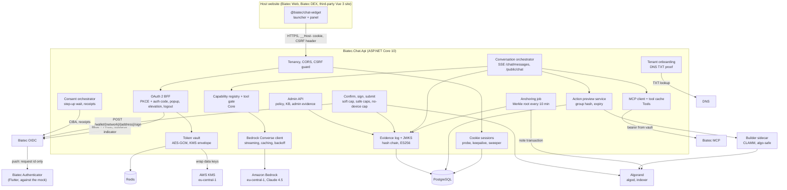
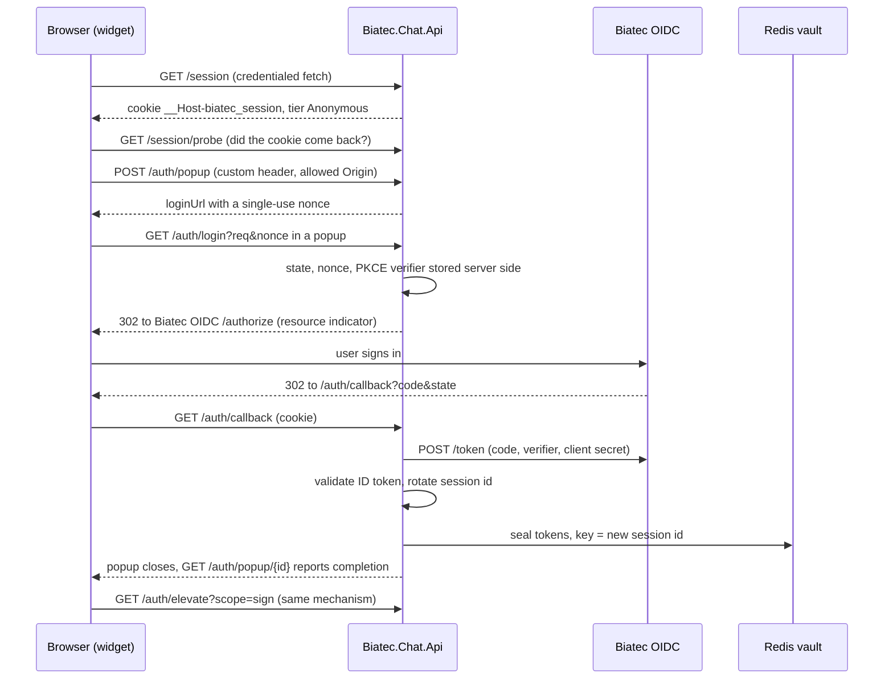

# Architecture

This is the integrator's and judge's map of Biatec Chat as it exists in this repository. [PRODUCT-DESCRIPTION.md](../PRODUCT-DESCRIPTION.md)
is the specification and wins on any conflict. Where a part is not built yet, or runs on a fallback because it depends on a
change in another product, this page says so. Status is as of the code on `main` when this page was written; the
[kanban board](../kanban/BOARD.md) is the live record.

Status words used below: **built** (code and tests on `main`), **partial** (some of it is built, the gap is named), **planned**
(specified, not in the code yet), **mock only** (works only against the in-repo mock Biatec OIDC).

## The pieces

| Piece | Path | Status |
| --- | --- | --- |
| Chat widget `@biatec/chat-widget` (Vue 3 plugin, shown to users as Biatec AI) | `packages/chat-widget` | built: Biatec AI design system in a Shadow DOM root ([design/README.md](design/README.md)), `theme: 'host'`, floating / inline / workspace modes, `useBiatecChat()` host API, cookie and public transports, conversation UI with sign-in popup, preview / consent / receipt cards, holdings, market and safe cards, permissions dialog with agent modes and pause, activity timeline, export and erase view, English and Slovak; published to npm (0.1.0) with a standalone build for non-Vue hosts ([integration-widget.md](integration-widget.md)) |
| Chat backend `Biatec.Chat.Api` (+ `.Core`, `.Tools`, `.Tests`) | `backend/` | built, see [Backend modules](#backend-modules) |
| Shared wire types `@biatec/chat-protocol` | `packages/chat-protocol` | built: generated from the backend OpenAPI document (`/contracts` only declares the types) |
| Biatec Consent Protocol: spec, JSON schemas, vectors, conformance suite | `packages/consent-protocol` | built |
| Mock Biatec OIDC (consent side) | `packages/consent-protocol/mock-oidc` | built: CIBA, step-up, receipts, enrollment, devices and settings, push outbox, JWKS |
| Offline evidence verifier | `packages/evidence-verifier` | built: CLI and library that check an export bundle against the JWKS |
| Builder sidecar for CLAMM, algo-safe and x402 | `builders/sidecar` | built: authenticated `POST /v1/build/{builder}` and `POST /v1/query/{query}`; pool list, pool swap, add and remove liquidity, safe create / list / proposals / propose / approve / execute, x402 payment (only with `X402_ENABLED=true`) |
| Authenticator (Flutter) | `apps/biatec_authenticator` | built against the mock OIDC: enrollment with a hardware device key, approvals with binding code, biometric check and signed receipts, FCM push, device / trusted-client / security settings screens. The native keystore code has never been compiled or run on a device ([README](../apps/biatec_authenticator/README.md)). Flutter is not needed to read or build the rest |
| Demo site | `apps/demo` | built, deployed to stage only ([demo-site.md](demo-site.md)) |
| End-to-end demo test | `e2e` | built: the demo script against the mock OIDC with a scripted phone; no backend, browser or testnet in the loop ([e2e/README.md](../e2e/README.md)) |
| Containers, Kubernetes, CI/CD | `backend/Dockerfile`, `builders/sidecar/Dockerfile`, `apps/demo/Dockerfile`, `k8s/`, `.github/workflows/` | built: stage deploys on every push to `main`, production by manual promotion ([cicd.md](cicd.md), [k8s/README.md](../k8s/README.md)); AWS is used for Bedrock only ([aws-setup.md](aws-setup.md)) |
| Local dependencies | `docker-compose.yml` | Redis 7 and PostgreSQL 16 on 127.0.0.1, plus the builders sidecar on :3100 |

## System diagram

The consent side (CIBA, receipts, device enrollment) exists only at the mock Biatec OIDC today; see
[Fallbacks](#fallbacks-for-changes-in-other-products) and [What is not built](#what-is-not-built-yet).

## Boundary rules and where they are enforced

| Rule (spec) | Where it lives | Status |
| --- | --- | --- |
| The browser never gets an access, refresh or ID token. It holds one opaque `__Host-biatec_session` cookie (`HttpOnly`, `Secure`, `SameSite=Lax`, `Path=/`, no `Domain`) | `Sessions/SessionService.cs`, `Auth/AuthEndpoints.cs` | built |
| Only the backend is the OAuth client; one confidential client per tenant, tenant derived from the `Host` header alone | `Tenancy/`, `Auth/OidcClient.cs` | built (needs the client registered at Biatec OIDC, see [required changes](required-changes-biatec-oidc.md)) |
| Model calls go from the backend to Bedrock only, in `eu-central-1`, Claude 4.5 models, `maxTokens` always set, prompt caching on the static system prompt, jittered backoff on throttling | `Model/BedrockModelClient.cs`, `Config/Options.cs` (region and model id are validated) | built |
| Tier and scope gates are enforced server-side, whatever the model says | `Core/Capabilities/ToolGate.cs`, called by `Orchestration/ConversationOrchestrator.cs`; agent mode (analyze or prepare, plus pause) in `Agent/` | built |
| Signing goes from the backend straight to Biatec OIDC `POST /wallet/{network}/{address}/sign`; MCP `signTransaction` is never called | `Chat/Confirm/ConfirmService.cs`, `Tools/Signing/WalletSigningClient.cs`; `ValuationBasis` and sign scopes live in the capability registry | built |
| The backend never hand-assembles transaction groups | builders are Biatec MCP and the sidecar (CLAMM, algo-safe, x402); `Tools/Algod/AlgorandGroup.cs` only assigns a missing group id; built groups are checked before a preview (for example `Tools/Dex/Swap/SwapGroupVerifier.cs`) | built |
| Tokens are encrypted in the vault, never logged or recorded | `Vault/` | built |

## Request lifecycle: sign-in and elevation

After sign-in the widget streams turns from `POST /chat/messages` (SSE; a visitor whose cookie does not come back uses
`POST /public/chat` with continuation tokens). A tool call that moves funds produces a preview; the user confirms it with
`POST /chat/previews/{previewId}/confirm`, the backend signs at Biatec OIDC and submits, and a consent challenge is followed
through `POST /chat/previews/{previewId}/consent` and `.../consent/stream`. The full flow is in
[the spec](../PRODUCT-DESCRIPTION.md#security-model-authorization-without-tokens-in-the-browser); the wire contract is
[packages/chat-protocol/openapi.json](../packages/chat-protocol/openapi.json).

## Backend modules

| Module | Path | What it does | Status |
| --- | --- | --- | --- |
| Config and health | `Config/`, `Health/` | Validated options (region must be `eu-central-1`, model ids must be `eu.anthropic.claude-*-4-*`); `GET /health` is 200 when Redis and PostgreSQL answer, else 503, body is the status only | built |
| Data model | `Core/Data/`, `Migrations/` | EF Core entities and migrations on PostgreSQL | built |
| Canonical JSON and hashing | `Core/Canonical/` | RFC 8785 canonicalizer and SHA-256 helpers, tested against the consent-protocol vectors | built |
| Tenancy, CORS, CSRF | `Tenancy/`, `Security/` | Host-header tenant; exact-origin credentialed CORS (never a wildcard); state-changing requests need the custom header, an allow-listed `Origin` and a registered client key; `/public/*` and `/onboarding/*` are cookie-less | built |
| Sessions | `Sessions/`, `Sweeper/` | Cookie session, 15 min idle, 8 h absolute, probe and keepalive; sweeper runs every minute and skips the idle term for a session with an open `ConsentRequest` | built |
| OAuth BFF | `Auth/` | Login popup with one-time nonce and `Sec-Fetch-*` checks, state bound to the cookie session, PKCE S256, ID token validation, session rotation, `/auth/callback` exempt from the cross-site check | built |
| Scope elevation | `Auth/Elevation/` | `/auth/elevate` accepts exactly `sign` or `manage-limits`, requests the union of held scopes plus the new one; `rekey` can never be asked for | built |
| Logout and revocation | `Auth/Logout/`, [security notes](security-notes-logout-and-revocation.md) | Revoke then delete; failed revocation goes to `PendingRevocation`; RP-initiated logout | built; IdP revocation endpoint not available yet (`Oidc:Revocation`) |
| Token vault | `Vault/` | Redis, AES-GCM envelope with a fresh data key per seal and the session id as associated data; `Dev` key provider locally, `Secret` provider (master key from a Kubernetes secret) in stage and production, `Kms` provider available; single-flight refresh through a Redis lock | built |
| Capability registry and gate | `Core/Capabilities/` | One registry for every capability (tier, scopes, moves-funds, valuation basis, JSON input schema, feature flag); tool lists per tier; rejection policy events; scope check before signing | built |
| Bedrock client and guardrails | `Model/`, `Model/Guardrails/` | Converse streaming, system prompt caching, history cache point, equal-jitter backoff on throttling; Bedrock Guardrails on the model stream and on untrusted tool results (`Bedrock:Guardrail`, off by default, on in `k8s/base`) | built; `dotnet run -- bedrock-smoke` is a manual check |
| Conversation orchestrator and chat endpoints | `Orchestration/`, `Chat/`, `Public/` | Tool loop through the gate, SSE on `POST /chat/messages`, anonymous `POST /public/chat` with continuation tokens and `POST /session/adopt`, `requestSignIn` and `kb.search` (`Kb:Path` pages plus admin uploads), the tenant's `defaultModel` and suggestions | built |
| Agent mode | `Agent/` | `PUT /session/agent`: mode `analyze` or `prepare` and a `paused` flag, enforced server-side on every fund-moving path | built |
| Wallet capabilities | `Wallet/`, `Tools/Wallet/` | `wallet.listAddresses` and `wallet.balance` (Algorand and Bitcoin) with the holdings card; `wallet.transfer` on Algorand with opt-in steps and on Bitcoin (PSBT intent hash, Esplora watcher, `Bitcoin:Esplora`) | built |
| DEX capabilities | `Dex/`, `Tools/Dex/`, `Market/` | `dex.swap` (Biatec MCP router first, else a sidecar pool swap), `dex.addLiquidity`, `dex.removeLiquidity`; `market.snapshot` card from public Biatec DEX data | built |
| Safe capabilities | `Safe/`, `Tools/Safe/` | `safe.create`, `safe.list`, `safe.propose`, `safe.approve`, `safe.execute` through the sidecar's algo-safe builders, and the safe card | built |
| Limits | `Limits/`, `Tools/Limits/` | `limits.view`; `limits.update` lowering-only, behind the tenant's `limitsUpdateEnabled` and the `manage-limits` scope | built |
| x402 | `X402/`, `Tools/X402/` | `x402.pay` behind `X402:Enabled` and the tenant flag ([x402-pay.md](x402-pay.md)) | built, off by default; not verified end to end on testnet |
| Confirm, sign and submit | `Chat/Confirm/`, `Chat/Cancel/`, `Tools/Signing/` | Confirm, cancel and reconcile endpoints, signing at Biatec OIDC, signed-group verification, submit | built |
| Spend caps | `Caps/`, `Tools/Caps/` | Tenant soft cap and safe approval and execution caps, reserved on the confirm path (`Caps`); reduced cap and above-threshold block for users without an active device (`Caps:NoDevice`) | built |
| Consent orchestrator | `Consent/` | Follows a step-up challenge (CIBA) to the receipt, streams its status, records the outcome; `GET .../consent/prediction` | built; real Biatec OIDC has no consent endpoints yet, so it runs against the mock |
| MCP client | `Tools/Mcp/` | Lazy tool discovery with the user's bearer, cache keyed by tenant and scope set, bearer from the vault | built |
| Action previews | `Core/Previews/`, `Tools/Algod/` | Previews and steps bound to a group hash, expiry from `lastValid`, 600 s Confirm gate, rebuild as a linked preview, multi-step sequencing, algod simulate client | built (library) |
| Evidence log | `Core/Evidence/`, `Evidence/Jwks/`, `Evidence/Keys/`, `Evidence/Recording/`, `Evidence/Export/` | Salted payload hash, hash-chained entries, ES256 signatures with shared rotating keys (`Evidence:KeyStore`), JWKS at `/.well-known/evidence-jwks.json`; recorded across chat, previews, signing and consent; signed export bundle at `GET /session/evidence`, checked offline by `packages/evidence-verifier` | built |
| Evidence anchoring | `Evidence/Anchoring/` | Every 10 minutes a Merkle root of conversation heads in an Algorand note; durable attempts; one replica per tick (advisory lock); verifier | built, off by default (`Evidence:Anchoring:Enabled`), on in `k8s/base` (testnet); a conversation's first entry carries `anchorRef`; `resume` and `end` entries and inclusion proofs in the bundle are not wired ([README](../backend/Biatec.Chat.Api/Evidence/Anchoring/README.md)); no recorded testnet run |
| Retention and erasure | `Retention/` | Hourly job: payloads go after 90 days, anonymous conversations after 30, records after 7 years (`Retention`); `GET /session/conversations`, `GET /session/conversations/{id}/evidence` and `POST /session/erase` for the user's own data | built |
| Admin API | `Admin/` | Operator-authenticated tenant list and policy (`PATCH .../{tenantId}/policy`), knowledge-base pages (upload, delete, reload), named operator keys (`Admin:Operators`), admin changes and tenant approvals in a signed admin evidence chain ([admin-api.md](admin-api.md)) | built |
| Tenant onboarding | `Onboarding/` | DNS TXT challenge, host and origin proof, operator approval fallback | built |
| Builder sidecar client | `Tools/Builders/` | Calls the Node sidecar with a shared secret header (`Builders`) | built |
| Bedrock budget | `Budget/` | Per-tenant and global spend caps per window; the breaker answers anonymous sessions from cached answers or a refusal | built |
| Telemetry | `Telemetry/` | OpenTelemetry traces (requests, HTTP, AWS SDK, Npgsql) and metrics (refusals per tier, policy violations, consent events) over OTLP; off unless `Telemetry:Enabled`; addresses, user agents and query strings are stripped | built |

## What is not built yet

Every task on the [board](../kanban/BOARD.md) is merged. What is still open, in this repository or because another product
has not shipped a change:

- **Consent at the real Biatec OIDC.** CIBA, receipts, device enrollment, the device and settings APIs and the valuation
  changes are not in Biatec OIDC yet, so phone approval works only against the mock (see the fallbacks below and
  [required-changes-biatec-oidc.md](required-changes-biatec-oidc.md)).
- **Authenticator on a device.** The Flutter platform folders are not generated and the native keystore code has never been
  compiled or run; Firebase push needs per-deployment configuration.
- **The rest of the anchoring wiring.** No `resume` or `end` entries, no inclusion proofs in the export bundle, and no
  recorded testnet run.
- **x402 end to end.** Tested against a mock facilitator only; no demo seller and no testnet run ([x402-pay.md](x402-pay.md)).
- **Tenant self-service onboarding.** Biatec OIDC has no dynamic client registration and no secret store that can write a
  tenant's client secret is bound (`UnconfiguredSecretStore`), so new tenants go through operator approval.
- **Production volumes.** `k8s/main` has no `storage.yaml` yet; it is needed before the first production deploy
  ([cicd.md](cicd.md#storage)).
- **Rule-based automation.** Not offered: the spec requires a confirmation per action, and the widget shows it disabled.

## Fallbacks for changes in other products

We only change this repository. Everything that needs a change in Biatec OIDC is listed with its fallback in
[required-changes-biatec-oidc.md](required-changes-biatec-oidc.md). The ones that shape the architecture today:

- No consent endpoints at the real Biatec OIDC: consent flows run against the mock only. The mock lives in
  `packages/consent-protocol/mock-oidc`, and the backend test mock for the login flow is `backend/Biatec.Chat.Tests/Auth/MockOidc.cs`.
- No confidential-client registration: an operator adds the tenant client, and onboarding answers `202 pending-operator-approval`.
- No revocation endpoint: logout destroys the vault entry and the refresh token ages out at the IdP (30 days today).
- Unknown application calls (Algo Safe, DEX pools) are treated as above threshold, so the phone is always asked.

## Data stores

| Store | Holds | Notes |
| --- | --- | --- |
| Redis | Vault entries (encrypted), refresh locks, auth state, Bedrock budget counters and cached answers, public-endpoint rate limits | Entry TTL is the absolute lifetime plus a 1 h grace; the sweeper, not Redis expiry, enforces the idle and absolute terms |
| PostgreSQL | Tenants, chat sessions, popup auth requests, conversations, messages, public conversation states, evidence entries, signing keys and anchors, previews and steps, consent requests, pending revocations, soft-cap spends, safe approval counts, known safes, knowledge-base pages | Migrations in `backend/Biatec.Chat.Api/Migrations` |
| AWS KMS | Optional: wraps the vault's data keys (`Vault:KeyProvider=Kms`) or holds the evidence keys (`Evidence:KeyStore=Kms`) | `eu-central-1`; not used by stage and production, which use the `Secret` providers with master keys from Kubernetes secrets; local dev uses a per-process or configured dev key |
| Secret store | Tenant OIDC client secrets, Redis and database credentials, evidence and anchor keys | Referenced by `secret://` names and read from configuration `Secrets:<path>` (in Kubernetes, environment variables from the cluster secrets, see [k8s/README.md](../k8s/README.md)); no store that can write a secret (tenant self-service onboarding) is bound yet |

## Hackathon AWS constraints that shape the code

Region `eu-central-1` only (Cost Explorer is the exception and runs in `us-east-1`); SSO profile `hackathon` locally and an IAM
role in AWS, no IAM users or access keys; Claude 4.5 model ids with the `eu.` prefix (Opus 4.5 for signed-in sessions,
Sonnet 4.5 for anonymous ones, Haiku 4.5 available); the 50 requests per minute limit is shared by the whole team, so the
client throttles and backs off with jitter; every resource is tagged `Project=biatec`; code freeze Tuesday 20 October 2026 13:30.
