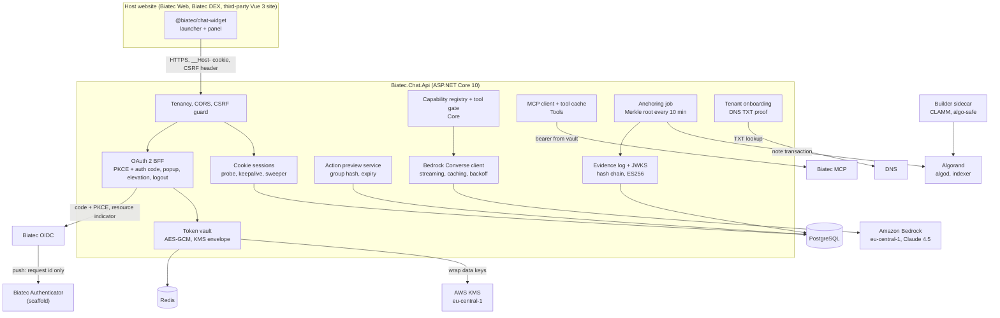
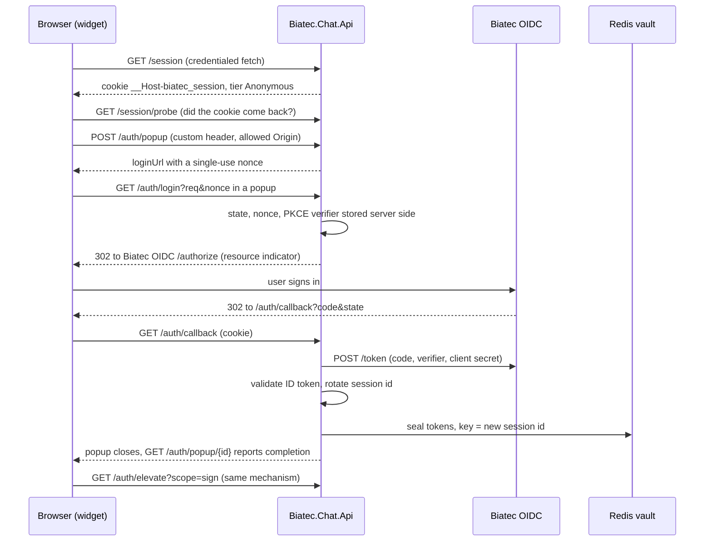

# Architecture

This is the integrator's and judge's map of Biatec Chat as it exists in this repository. [PRODUCT-DESCRIPTION.md](../PRODUCT-DESCRIPTION.md)
is the specification and wins on any conflict. Where a part is not built yet, or runs on a fallback because it depends on a
change in another product, this page says so. Status is as of the code on `main` when this page was written; the
[kanban board](../kanban/BOARD.md) is the live record.

Status words used below: **built** (code and tests on `main`), **partial** (some of it is built, the gap is named), **planned**
(specified, not in the code yet), **mock only** (works only against the in-repo mock Biatec OIDC).

## The pieces

| Piece | Path | Status |
| --- | --- | --- |
| Chat widget `@biatec/chat-widget` (Vue 3 plugin, shown to users as Biatec AI) | `packages/chat-widget` | partial: launcher, panel, plugin install, transport. Chat UI is in progress; the rework to the Biatec AI design system ([design/README.md](design/README.md)), preview/consent cards, permissions and activity are planned |
| Chat backend `Biatec.Chat.Api` (+ `.Core`, `.Tools`, `.Tests`) | `backend/` | partial, see the table below |
| Shared wire types `@biatec/chat-protocol` | `packages/chat-protocol` | built: generated from the backend OpenAPI document (`/contracts` only declares the types) |
| Biatec Consent Protocol: spec, JSON schemas, vectors | `packages/consent-protocol` | built; the conformance suite is in progress |
| Mock Biatec OIDC (consent side) | `packages/consent-protocol/mock-oidc` | built: CIBA, step-up, receipts, enrollment, JWKS |
| Builder sidecar for CLAMM and algo-safe | `builders/sidecar` | partial: authenticated build endpoint and builder registry; the concrete CLAMM and safe builders are in progress |
| Authenticator (Flutter) | `apps/biatec_authenticator` | scaffold only: navigation and empty screens, no network calls. Flutter is not needed to read or build the rest |
| Local dependencies | `docker-compose.yml` | Redis 7 and PostgreSQL 16 on 127.0.0.1 |

## System diagram

The diagram leaves out the parts of the full product that are not in the code yet (the conversation orchestrator, signing at
Biatec OIDC, the consent orchestrator); see [What is not built](#what-is-not-built-yet).

## Boundary rules and where they are enforced

| Rule (spec) | Where it lives | Status |
| --- | --- | --- |
| The browser never gets an access, refresh or ID token. It holds one opaque `__Host-biatec_session` cookie (`HttpOnly`, `Secure`, `SameSite=Lax`, `Path=/`, no `Domain`) | `Sessions/SessionService.cs`, `Auth/AuthEndpoints.cs` | built |
| Only the backend is the OAuth client; one confidential client per tenant, tenant derived from the `Host` header alone | `Tenancy/`, `Auth/OidcClient.cs` | built (needs the client registered at Biatec OIDC, see [required changes](required-changes-biatec-oidc.md)) |
| Model calls go from the backend to Bedrock only, in `eu-central-1`, Claude 4.5 models, `maxTokens` always set, prompt caching on the static system prompt, jittered backoff on throttling | `Model/BedrockModelClient.cs`, `Config/Options.cs` (region and model id are validated) | built |
| Tier and scope gates are enforced server-side, whatever the model says | `Core/Capabilities/ToolGate.cs` | built as a library; wired into the conversation loop by the orchestrator task (in progress) |
| Signing goes from the backend straight to Biatec OIDC `POST /wallet/{network}/{address}/sign`; MCP `signTransaction` is never called | design rule; `ValuationBasis` and sign scopes live in the capability registry | planned: the confirm-and-sign task has not landed |
| The backend never hand-assembles transaction groups | builders are Biatec MCP, the sidecar (CLAMM, algo-safe); `Tools/Algod/AlgorandGroup.cs` only assigns a missing group id | partial |
| Tokens are encrypted in the vault, never logged or recorded | `Vault/` | built |

## Request lifecycle (what runs today)

The rest of the spec's flow (chat message, tool call, preview, confirm, sign, consent) builds on this and is described in
[the spec](../PRODUCT-DESCRIPTION.md#security-model-authorization-without-tokens-in-the-browser).

## Backend modules

| Module | Path | What it does | Status |
| --- | --- | --- | --- |
| Config and health | `Config/`, `Health/` | Validated options (region must be `eu-central-1`, model ids must be `eu.anthropic.claude-*-4-*`); `GET /health` is 200 when Redis and PostgreSQL answer, else 503, body is the status only | built |
| Data model | `Core/Data/`, `Migrations/` | EF Core entities and migrations on PostgreSQL | built |
| Canonical JSON and hashing | `Core/Canonical/` | RFC 8785 canonicalizer and SHA-256 helpers, tested against the consent-protocol vectors | built |
| Tenancy, CORS, CSRF | `Tenancy/`, `Security/` | Host-header tenant; exact-origin credentialed CORS (never a wildcard); state-changing requests need the custom header, an allow-listed `Origin` and a registered client key; `/public/*` and `/onboarding/*` are cookie-less | built |
| Sessions | `Sessions/`, `Sweeper/` | Cookie session, 15 min idle, 8 h absolute, probe and keepalive; sweeper runs every minute and skips the idle term for a session with an open `ConsentRequest` | built |
| OAuth BFF | `Auth/` | Login popup with one-time nonce and `Sec-Fetch-*` checks, state bound to the cookie session, PKCE S256, ID token validation, session rotation, `/auth/callback` exempt from the cross-site check | built |
| Scope elevation | `Auth/Elevation/` | `/auth/elevate` accepts exactly `sign` or `manage-limits`, requests the union of held scopes plus the new one; `rekey` can never be asked for | built |
| Logout and revocation | `Auth/Logout/`, [security notes](security-notes-logout-and-revocation.md) | Revoke then delete; failed revocation goes to `PendingRevocation`; RP-initiated logout | built; IdP revocation endpoint not available yet |
| Token vault | `Vault/` | Redis, AES-GCM envelope with a fresh data key per seal and the session id as associated data; `Dev` key provider locally, `Kms` provider for AWS; single-flight refresh through a Redis lock | built |
| Capability registry and gate | `Core/Capabilities/` | One registry for every capability (tier, scopes, moves-funds, valuation basis, JSON input schema, feature flag); tool lists per tier; rejection policy events; scope check before signing | built |
| Bedrock client | `Model/` | Converse streaming, system prompt caching, history cache point, equal-jitter backoff on throttling | built; `dotnet run -- bedrock-smoke` is a manual check |
| MCP client | `Tools/Mcp/` | Lazy tool discovery with the user's bearer, cache keyed by tenant and scope set, bearer from the vault | built |
| Action previews | `Core/Previews/`, `Tools/Algod/` | Previews and steps bound to a group hash, expiry from `lastValid`, 600 s Confirm gate, rebuild as a linked preview, multi-step sequencing, algod simulate client | built (library) |
| Evidence log | `Core/Evidence/`, `Evidence/Jwks/` | Salted payload hash, hash-chained entries, ES256 signatures with rotating keys, JWKS at `/.well-known/evidence-jwks.json`, offline verifier | built; recording from the conversation flow and the export bundle are planned |
| Evidence anchoring | `Evidence/Anchoring/` | Every 10 minutes a Merkle root of conversation heads in an Algorand note; durable attempts; verifier | built, off by default (`Evidence:Anchoring:Enabled`); not yet called from a conversation; no recorded testnet run |
| Tenant onboarding | `Onboarding/` | DNS TXT challenge, host and origin proof, operator approval fallback | built |
| Builder sidecar client | `Tools/Builders/` | Calls the Node sidecar with a shared secret header | built |
| Bedrock budget | `Budget/` | Per-tenant and global spend caps per window; the breaker answers anonymous sessions from cached answers or a refusal | built |
| Telemetry | `Telemetry/` | OpenTelemetry traces (requests, HTTP, AWS SDK, Npgsql) and metrics (refusals per tier, policy violations, consent events) over OTLP; off unless `Telemetry:Enabled`; addresses, user agents and query strings are stripped | built |

## What is not built yet

These are specified in the product description and tracked on the board. The docs elsewhere never imply otherwise.

- Conversation orchestrator and the SSE chat endpoint (in progress), the anonymous `requestSignIn` and knowledge-base tools, and the public anonymous endpoint `/public/chat`.
- Confirm-and-sign at Biatec OIDC, submit, the wallet, DEX and safe capability executors, the tenant soft cap and the backend consent orchestrator.
- Widget chat UI, action preview and consent cards, i18n (English, Slovak).
- Widget rework to the Biatec AI design system (T-062 to T-069): tokens and Shadow DOM isolation, `theme: 'host'`, floating / inline / workspace modes, the `useBiatecChat()` host API, the agent-mode permissions dialog with its server-side enforcement, the activity timeline, data cards, and the Biatec DEX integration ([integration-biatec-dex.md](integration-biatec-dex.md)).
- Authenticator enrollment, approval and push.
- Evidence export bundle, retention jobs and user erasure, the x402 capability.
- Containers, Kubernetes manifests and the hackathon hosting scripts.

## Fallbacks for changes in other products

We only change this repository. Everything that needs a change in Biatec OIDC is listed with its fallback in
[required-changes-biatec-oidc.md](required-changes-biatec-oidc.md). The ones that shape the architecture today:

- No consent endpoints at the real Biatec OIDC: consent flows run against the mock only. The mock lives in
  `packages/consent-protocol/mock-oidc`, and the backend test mock for the login flow is `backend/Biatec.Chat.Tests/Auth/MockOidc.cs`.
- No confidential-client registration: an operator adds the tenant client, and onboarding answers `202 pending-operator-approval`.
- No revocation endpoint: logout destroys the vault entry and the refresh token ages out at the IdP (30 days today).
- Unknown application calls (Algo Safe, DEX pools) are treated as above threshold, so the phone is always asked.

## Data stores

| Store | Holds | Notes |
| --- | --- | --- |
| Redis | Vault entries (encrypted), refresh locks, auth state | Entry TTL is the absolute lifetime plus a 1 h grace; the sweeper, not Redis expiry, enforces the idle and absolute terms |
| PostgreSQL | Tenants, chat sessions, popup auth requests, conversations, messages, evidence entries and anchors, previews and steps, consent requests, pending revocations | Migrations in `backend/Biatec.Chat.Api/Migrations` |
| AWS KMS | Wraps the vault's data keys | `eu-central-1`; local dev uses a per-process or configured dev key |
| Secret store | Tenant OIDC client secrets, Redis and database credentials, evidence and anchor keys | Referenced by `secret://` names, supplied as configuration `Secrets:<path>`; a real Secrets Manager or Kubernetes implementation is not written yet |

## Hackathon AWS constraints that shape the code

Region `eu-central-1` only (Cost Explorer is the exception and runs in `us-east-1`); SSO profile `hackathon` locally and an IAM
role in AWS, no IAM users or access keys; Claude 4.5 model ids with the `eu.` prefix (Opus 4.5 for signed-in sessions,
Sonnet 4.5 for anonymous ones, Haiku 4.5 available); the 50 requests per minute limit is shared by the whole team, so the
client throttles and backs off with jitter; every resource is tagged `Project=biatec`; code freeze Tuesday 20 October 2026 13:30.
