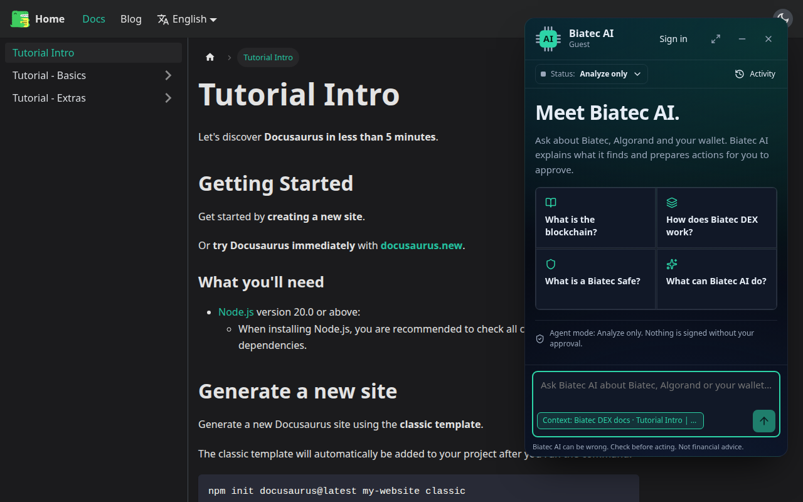
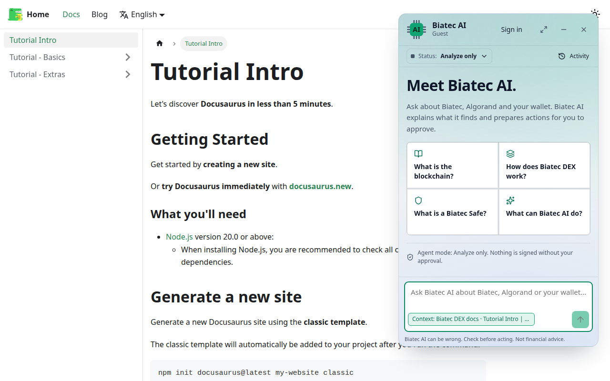

# Embedding Biatec AI in the BiatecCLAMM documentation site

How the chat widget (`@biatec/chat-widget`, shown to users as **Biatec AI**) goes into the Docusaurus site of
[`scholtz/BiatecCLAMM`](https://github.com/scholtz/BiatecCLAMM) (folder `docusaurus/`). The specification is
[PRODUCT-DESCRIPTION.md](../PRODUCT-DESCRIPTION.md); the general integration guide is
[integration-widget.md](integration-widget.md). The Vue host hand-off for Biatec DEX is
[integration-biatec-dex.md](integration-biatec-dex.md).

This repository never edits BiatecCLAMM. This file is the hand-off: the changes under "Host changes" are made in the
BiatecCLAMM repository by its maintainers, against the standalone widget entry this repo publishes
(`@biatec/chat-widget/standalone`, T-099). Every step was followed literally in a scratch Docusaurus 3.9.2 site
(React 18, the same CommonJS config shape, locales en/sk/pl) on 2026-10-20, in headless Chromium: `docusaurus build`
succeeds for all three locales, the server-rendered HTML contains no widget code (the widget is its own lazy chunk),
`/`, `/docs/intro`, `/blog`, `/sk/docs/intro` and `/pl/docs/intro` each render exactly one launcher (`lang` `en`,
`en`, `en`, `sk`, `en`), client-side navigation keeps the same widget, neither `docusaurus serve` nor
`docusaurus start` logs a hydration warning or page error, and the navbar light/dark switch flips the widget both
ways (screenshots at the end).

**Prerequisite:** `@biatec/chat-widget@0.1.0` is on npm. Until the first publish (see `packages/chat-widget/README.md`,
"Publishing"), install the tarball from this repo instead:
`pnpm --filter @biatec/chat-widget build && cd packages/chat-widget && pnpm pack`, then
`yarn add file:/path/to/biatec-chat-widget-0.1.0.tgz`.

## What the BiatecCLAMM site looks like to the widget

Read from `scholtz/BiatecCLAMM` `main` on 2026-10-20:

| Aspect | BiatecCLAMM `docusaurus/` | What the widget does |
| --- | --- | --- |
| Framework | Docusaurus `^3.9.2`, `@docusaurus/preset-classic`, React 18, yarn, CommonJS `docusaurus.config.js` (`module.exports = {…}`) | React cannot `app.use()` a Vue plugin: the site uses the standalone entry, which bundles its own Vue and mounts outside the React tree |
| Rendering | Static site generation: every page is rendered in Node, then hydrated | The widget module is loaded with a dynamic `import()` only in the browser, after hydration (`onRouteDidUpdate` of a client module); the server never touches `window` or the widget |
| Dark mode | Infima: `<html data-theme="dark|light">`, switched by the navbar toggle (and `prefers-color-scheme` on first visit) | `theme: 'host'` with `hostDarkAttribute: 'data-theme=dark'` (the standalone default): follows the toggle live through a `MutationObserver` |
| Theme colours | `--ifm-color-primary: #25c2a0` (custom.css) | Biatec AI keeps its own tokens (`#2DD4A7` in dark), which are close; no override needed |
| i18n | `i18n.locales: ['en', 'sk', 'pl']` (an `i18n/hu` folder exists but is not configured); each locale is its own build under `/sk/`, `/pl/`; `<html lang>` is the locale | `locale` from `document.documentElement.lang`: `sk` gets the Slovak catalog, `en` English, `pl` and `hu` fall back to English. Switching language is a full page load, so it is read once |
| Routing | Client-side navigation between docs pages | `onRouteDidUpdate` updates the page context on every navigation; the widget and its conversation survive navigation |
| `url` | `https://beta.dex.biatec.io` (site origin) | Decides the tier, see "Backend host" |
| Bottom-right | The classic theme's "Back to top" button (bottom/right `1.3rem`, shown after scrolling) | The launcher sits 24 px from the bottom right; step 4 lifts it above that button |

## Host changes in BiatecCLAMM

### 1. Dependency (`docusaurus/package.json`)

```sh
cd docusaurus
yarn add @biatec/chat-widget@^0.1.0
```

`vue` is an optional peer dependency used only by the Vue plugin; the standalone entry bundles Vue, so nothing else
is installed into the site.

### 2. Widget settings (`docusaurus/docusaurus.config.js`)

Add two keys to the exported object (next to `plugins`). The backend URL can be overridden from `.env`, which the
config already loads with `dotenv`, so a staging build can point at the staging backend:

```js
    clientModules: [require.resolve('./src/clientModules/biatecChat.js')],
    customFields: {
      biatecChat: {
        backendUrl: process.env.BIATEC_CHAT_URL || 'https://chat.biatec.io',
        clientKey: process.env.BIATEC_CHAT_CLIENT_KEY || 'biatec-clamm-docs', // a label, not a secret
      },
    },
```

### 3. The client module (`docusaurus/src/clientModules/biatecChat.js`, new file)

```js
// Biatec AI chat widget (@biatec/chat-widget). Client modules are also evaluated during the server build, so the
// widget is imported only in the browser, after the first render has hydrated (onRouteDidUpdate fires on the initial
// load too). It mounts outside the React root, in its own shadow DOM, and survives client-side navigation.
import ExecutionEnvironment from '@docusaurus/ExecutionEnvironment';
import siteConfig from '@generated/docusaurus.config';

let chat = null;

/** The mounted widget's handle, as a promise: mounts on first use. Also used by AskBiatecAi (step 5). */
export function widget() {
  if (!chat) {
    const { backendUrl, clientKey } = siteConfig.customFields.biatecChat;
    chat = import('@biatec/chat-widget/standalone').then(({ mountBiatecChat }) =>
      mountBiatecChat({
        backendUrl,
        clientKey,
        locale: document.documentElement.lang || 'en', // Docusaurus i18n: en, sk; pl and hu fall back to English
        theme: 'host',
        hostDarkAttribute: 'data-theme=dark', // Infima's <html data-theme>, switched by the navbar toggle
      }),
    );
  }
  return chat;
}

export function onRouteDidUpdate({ location }) {
  if (!ExecutionEnvironment.canUseDOM) return;
  widget()
    .then((c) =>
      // After the new page's <title> is set. Only sent with a message the user types; untrusted data to the backend.
      setTimeout(() => c.setPageContext(`Biatec DEX docs · ${document.title} · ${location.pathname}`), 0),
    )
    .catch((e) => console.error('[biatec-chat]', e));
}
```

`@docusaurus/ExecutionEnvironment` and `@generated/docusaurus.config` are Docusaurus' own modules; nothing is added
to the React tree, so there is nothing to hydrate and no `src/theme/Root.js` swizzle is needed. (A site that prefers
a `Root.js` wrapper can call the same `widget()` from a `useEffect`; never at module top level.)

### 4. Position (`docusaurus/src/css/custom.css`)

Lift the launcher above the "Back to top" button:

```css
[data-biatec-chat-host] {
  --bc-offset-bottom: 4.5rem;
}
```

`--bc-offset-right` and `--bc-z` (default 1000, above Infima's navbar at 200 and the mobile sidebar) can be set the
same way. No stylesheet import is needed: the widget injects its CSS into its own shadow root, and Infima cannot reach
it.

### 5. Optional "Ask Biatec AI" links in docs pages

MDX can call the same host API, for example under the liquidity docs. The component waits for the same mount promise
as the client module (`widget()` from step 3), so a click that comes before the lazy chunk has loaded still reaches a
mounted widget instead of getting `'unavailable'` (the scratch site builds this component into a docs page):

```jsx
// docusaurus/src/components/AskBiatecAi.js
import React from 'react';
import ExecutionEnvironment from '@docusaurus/ExecutionEnvironment';
import { widget } from '@site/src/clientModules/biatecChat';

export default function AskBiatecAi({ prompt, children }) {
  const ask = () => {
    if (!ExecutionEnvironment.canUseDOM) return;
    widget()
      .then((chat) => chat.ask(prompt))
      .catch((e) => console.error('[biatec-chat]', e));
  };
  return <button type="button" className="button button--secondary button--sm" onClick={ask}>{children}</button>;
}
```

```mdx
import AskBiatecAi from '@site/src/components/AskBiatecAi';

<AskBiatecAi prompt="Explain concentrated liquidity ranges on Biatec DEX">Ask Biatec AI</AskBiatecAi>
```

`ask` opens the panel and sends the prompt as a visible user message; nothing is executed without the user's review
and Confirm.

## Backend host, tier and origin registration

The cookie that gives the signed-in tier must be first-party (same registrable domain) to the page; the widget never
uses third-party cookies (spec, Embedding Modes).

| Site served from | Backend (`BIATEC_CHAT_URL`) | Tier | Operator step |
| --- | --- | --- | --- |
| `https://beta.dex.biatec.io` (the configured `url`) | `https://chat.biatec.io` (production) or `https://stage.chat.biatec.io` (stage) | Authenticated: `beta.dex.biatec.io` and `chat.biatec.io` are same-site (`biatec.io`), so this is the "Biatec sites" mode, credentialed CORS with the exact origin | Add `https://beta.dex.biatec.io` to the Biatec tenant's `allowedOrigins` (with its own DNS TXT proof `_biatec-chat-challenge.beta.dex.biatec.io`; a sibling name is never inferred) and `biatec-clamm-docs` to its `clientKeys`. No new backend host is needed |
| Any other `*.biatec.io` name | same | Authenticated | The same, for that exact origin |
| A host outside `biatec.io` (for example GitHub Pages) | same | Anonymous only (public endpoint): the cookie could never be first-party | None; the widget logs one console warning and answers questions without sign-in |
| `http://localhost:3000` (`yarn start`) | a local backend `http://localhost:5000`, `BIATEC_CHAT_CLIENT_KEY=dev` | Anonymous unless the local dev tenant lists `http://localhost:3000` (it lists `http://localhost:5173`) | Optional: add the origin to the dev tenant seed |

Until the origin is registered, the site still works in the anonymous tier against the same backend; registration is
an operator step and is not done by this repository.

### Content Security Policy

The site sets no CSP today. If one is added: `connect-src https://chat.biatec.io` (and the stage host), popups to
`https://chat.biatec.io` and `https://oidc.biatec.io` allowed (no `Cross-Origin-Opener-Policy: same-origin` on the
docs pages, or the sign-in popup cannot report back), `script-src 'self'` covers the bundled widget, and `style-src`
must allow the one `<style>` element the widget writes into its shadow root (`'unsafe-inline'` or a nonce, as Infima
already needs).

## Checks before shipping in BiatecCLAMM

- [ ] `yarn build` succeeds (the server build never imports the widget) and `yarn serve` shows the launcher on the
      home page, a docs page, the blog and the `/sk/` build.
- [ ] The browser console shows no React hydration warning on a hard reload of a docs page.
- [ ] The navbar light/dark toggle switches the widget without reload.
- [ ] `/sk/` shows the widget in Slovak, `/pl/` in English.
- [ ] Navigating between docs pages keeps the open conversation; a question asked after navigating is about the new
      page.
- [ ] The launcher does not cover the "Back to top" button (scroll down a long page).
- [ ] Network tab: no OAuth token or code reaches the page; with the origin registered, Sign in opens the Biatec OIDC
      popup and the header then shows the signed-in email.

## Known limitations

Found with the scratch site; the fixes belong to the widget, not to the site:

- On a short desktop window (800 px high) the open floating panel is up to 700 px tall and, lifted by
  `--bc-offset-bottom`, covers the right end of the navbar (the theme toggle on a site without a GitHub link).
  Closing or minimizing the panel uncovers it.
- `document.title` includes the site title suffix (`Tutorial Intro | Biatec DEX`), so the page context repeats it.
  Harmless; trim it in `onRouteDidUpdate` if wanted.
- Unrelated to the widget: a fresh `npm install` of Docusaurus 3.9.2 resolves webpack 5.112, whose ProgressPlugin
  schema `webpackbar` fails ("Invalid options object. Progress Plugin…"). BiatecCLAMM's `yarn.lock` pins an older
  webpack; the scratch site needed `"overrides": { "webpack": "5.99.9" }`.

## Screenshots

The scratch site from the steps above, a docs page with the panel open, in both themes (navbar toggle):

| Dark | Light |
| --- | --- |
|  |  |

## Size

The standalone ES module the site imports is code-split into its own chunk, loaded after the first render. Its IIFE
equivalent is about 300 kB minified, under the **110 kB gzip budget** enforced by
`packages/chat-widget/test/standalone.test.ts` (Vue, vue-i18n, icons and CSS included).
