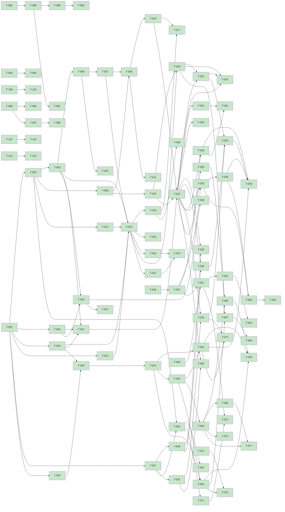

# Board

> Generated by `kanban/scripts/board.py` (`/kanban-board`) from `kanban/tasks/*.md`. Don't edit by hand; the
> task files are the source of truth. Rules: `kanban/README.md`.

Updated: 2026-10-23 12:13 · Tasks: 139 total · backlog 0 · in-progress 1 · blocked 0 · review 0 · done 138

## Review (waiting for the user)

| ID | Title | Branch | In review since | Open questions |
|---|---|---|---|---|

## In progress

| ID | Title | Priority | Taken by | Owner | Branch | Since |
|---|---|---|---|---|---|---|
| T-202 | Install the mock OIDC image from the workspace lock; run the verifier and conformance suites in CI (BCHAT-044) | P3 | scholtz | session-20261023-1213 | task/T-202 | 2026-10-23 12:13 |

## Blocked

| ID | Title | Priority | Blocked by (not done yet) | Parallel | Taken by |
|---|---|---|---|---|---|

## Backlog

Sorted by priority, then ID. The first row is what `/kanban-next` picks.

| ID | Title | Priority | Epic | Parallel | Taken by |
|---|---|---|---|---|---|

## Done

| ID | Title | Approved on |
|---|---|---|
| T-001 | Scaffold monorepo and backend solution | 2026-10-19 |
| T-002 | Backend config, options and health endpoint | 2026-10-19 |
| T-003 | EF Core data model and migrations | 2026-10-19 |
| T-004 | RFC 8785 canonical JSON and hashing library | 2026-10-19 |
| T-005 | chat-protocol package generated from backend OpenAPI | 2026-10-19 |
| T-006 | Tenant resolution, CORS and CSRF guard | 2026-10-19 |
| T-007 | Cookie session, probe and keepalive | 2026-10-19 |
| T-008 | Encrypted token vault in Redis | 2026-10-19 |
| T-009 | OAuth BFF login with PKCE and popup | 2026-10-19 |
| T-010 | Scope elevation for sign and manage-limits | 2026-10-19 |
| T-011 | Logout, sweeper and pending revocation | 2026-10-19 |
| T-012 | Bedrock Converse streaming client | 2026-10-19 |
| T-013 | Capability registry and tier gate | 2026-10-19 |
| T-014 | Conversation orchestrator and SSE chat endpoint | 2026-10-19 |
| T-015 | Anonymous tier: requestSignIn and knowledge base search | 2026-10-19 |
| T-016 | Bedrock Guardrails on model and tool results | 2026-10-19 |
| T-017 | Tier policy test suite | 2026-10-20 |
| T-018 | Bedrock budget and circuit breaker | 2026-10-19 |
| T-019 | Biatec MCP client with lazy tool cache | 2026-10-19 |
| T-020 | wallet.listAddresses and wallet.balance | 2026-10-19 |
| T-021 | Action preview, group hash and expiry | 2026-10-19 |
| T-022 | Confirm, sign at Biatec OIDC and submit | 2026-10-19 |
| T-023 | wallet.transfer on Algorand with opt-in steps | 2026-10-20 |
| T-024 | wallet.transfer on Bitcoin (PSBT intent hash) | 2026-10-20 |
| T-025 | Tenant soft cap and safe approval caps | 2026-10-20 |
| T-026 | limits.view and lowering-only limits.update | 2026-10-20 |
| T-027 | Node builder sidecar for CLAMM and algo-safe | 2026-10-19 |
| T-028 | Pool discovery and liquidity builders | 2026-10-19 |
| T-029 | dex.swap capability | 2026-10-20 |
| T-030 | dex.addLiquidity and dex.removeLiquidity capabilities | 2026-10-20 |
| T-031 | Safe builders in sidecar (algo-safe) | 2026-10-19 |
| T-032 | safe.create and safe.list capabilities | 2026-10-20 |
| T-033 | safe.propose, approve and execute capabilities | 2026-10-20 |
| T-034 | Evidence log hash chain and signing keys | 2026-10-19 |
| T-035 | Record evidence across chat, previews and signing | 2026-10-20 |
| T-036 | Evidence export bundle and offline verifier | 2026-10-20 |
| T-037 | On-chain evidence anchoring | 2026-10-19 |
| T-038 | Public anonymous endpoint with continuation tokens | 2026-10-20 |
| T-039 | Widget package scaffold, launcher and panel | 2026-10-19 |
| T-040 | Widget transport: cookie probe, public fallback, SSE | 2026-10-19 |
| T-041 | Widget chat UI and sign-in popup | 2026-10-19 |
| T-042 | Widget action preview, consent and receipt cards | 2026-10-20 |
| T-043 | Widget Slovak translation and accessibility pass | 2026-10-20 |
| T-044 | Required OIDC changes handoff document | 2026-10-19 |
| T-045 | Tenant onboarding API with domain verification | 2026-10-19 |
| T-046 | Consent protocol spec, schemas and test vectors | 2026-10-19 |
| T-047 | Mock Biatec OIDC consent server | 2026-10-19 |
| T-048 | Consent conformance test suite | 2026-10-19 |
| T-049 | Backend consent orchestrator | 2026-10-20 |
| T-050 | Authenticator Flutter app scaffold | 2026-10-19 |
| T-051 | Authenticator enrollment and device key | 2026-10-19 |
| T-052 | Authenticator approval flow and receipts | 2026-10-19 |
| T-053 | Authenticator push notifications | 2026-10-19 |
| T-054 | Containers and k8s manifests | 2026-10-19 |
| T-055 | Hackathon AWS hosting plan and scripts | 2026-10-19 |
| T-056 | Architecture, threat model and demo docs | 2026-10-19 |
| T-057 | OpenTelemetry traces and metrics | 2026-10-20 |
| T-058 | x402.pay capability behind feature flag | 2026-10-20 |
| T-059 | End-to-end demo test on testnet | 2026-10-20 |
| T-060 | Retention jobs and user erasure | 2026-10-20 |
| T-061 | Backend fallback cap for users without an active device | 2026-10-20 |
| T-062 | Widget design foundations: Biatec AI tokens, Shadow DOM, theme sync, primitives | 2026-10-20 |
| T-063 | Widget shell: launcher, panel modes, header and host API | 2026-10-20 |
| T-064 | Widget conversation UI to the Biatec AI design | 2026-10-20 |
| T-065 | Session agent mode (analyze / prepare) and pause, enforced server-side | 2026-10-20 |
| T-066 | Widget permissions dialog, pause/revoke and activity timeline | 2026-10-20 |
| T-067 | Holdings data card from wallet.balance | 2026-10-20 |
| T-068 | BiatecDEX integration playground and hand-off doc | 2026-10-20 |
| T-069 | market.snapshot capability and market card from Biatec DEX data | 2026-10-20 |
| T-070 | Count budget-breaker refusals in the refusals metric | 2026-10-20 |
| T-071 | CI/CD pipelines, stage deploy and production promotion | 2026-10-20 |
| T-072 | Fix failing authenticator enrollment tests | 2026-10-20 |
| T-073 | Document the widget host API in the integration docs | 2026-10-20 |
| T-074 | Widget safe card for safe.list and safe.create | 2026-10-20 |
| T-075 | Backend preview cancel endpoint | 2026-10-20 |
| T-076 | Wire preview, consent and receipt cards into the conversation | 2026-10-20 |
| T-077 | Widget fixes for coexisting with host dialogs (Esc, focus trap, lang, chip export) | 2026-10-20 |
| T-078 | Bug: persistent, shared evidence signing keys and JWKS | 2026-10-20 |
| T-079 | Bug: report the page origin, not the backend host, on signing requests | 2026-10-20 |
| T-080 | Bug: a session awaiting phone consent must stay live past the idle timeout | 2026-10-20 |
| T-081 | Bug: anchorRef in the entry hash must be the anchor transaction ID | 2026-10-20 |
| T-082 | Bug: wallet.listAddresses and wallet.balance must cover Bitcoin | 2026-10-20 |
| T-083 | Bug: session endpoint must return the signed-in email and primary address | 2026-10-20 |
| T-084 | Bug: authenticator device management, trusted clients and security settings screens | 2026-10-20 |
| T-085 | Bug: apply the tenant's defaultModel and suggestions | 2026-10-20 |
| T-086 | Bug: admin API for policy and knowledge-base management | 2026-10-20 |
| T-087 | Bug: agent-mode gate consistency (preview tools, limit lowering, no Elevated tier) | 2026-10-20 |
| T-088 | Bug: evidence anchoring with two replicas and in the k8s deployment | 2026-10-20 |
| T-089 | Bug: Algorand transfer preview must use MCP network codes and the error field | 2026-10-20 |
| T-090 | Bug: transfer preview must look up ASA decimals and unit name (real MCP balances carry none) | 2026-10-20 |
| T-091 | Adopt McpNetworks.Algorand in the remaining hand-built network codes | 2026-10-20 |
| T-092 | Session endpoint: return the session's OIDC scope names | 2026-10-20 |
| T-093 | Safe proposal card: use the shared algod asset reader | 2026-10-20 |
| T-094 | Widget: export view and erase button for the user's own conversations | 2026-10-20 |
| T-095 | Fix the red widget i18n test and the flaky session-profile test on main | 2026-10-20 |
| T-096 | Admin: knowledge-base reload and upload | 2026-10-20 |
| T-097 | Admin: per-operator identity and evidence for admin changes | 2026-10-20 |
| T-098 | Onboarding: record operator tenant approvals in the admin evidence chain | 2026-10-20 |
| T-099 | Publish @biatec/chat-widget to npm and embed it in BiatecCLAMM | 2026-10-20 |
| T-100 | Showcase demo site deployed to stage | 2026-10-20 |
| T-101 | Bug: widget cookie transport must POST /chat/messages | 2026-10-20 |
| T-102 | DEX playground page: fix serious axe violations | 2026-10-20 |
| T-103 | docs/cicd.md: document the demo image and pipeline | 2026-10-20 |
| T-104 | Floating panel must not cover the host navbar on short viewports | 2026-10-20 |
| T-105 | npm pipeline: release @biatec/chat-widget automatically on a version bump | 2026-10-20 |
| T-106 | Docs consistency audit: make every doc match the code on main | 2026-10-20 |
| T-107 | Keep message payloads 5 years instead of 90 days | 2026-10-20 |
| T-108 | Widget: render assistant replies as safe Markdown | 2026-10-20 |
| T-109 | Fix add-liquidity flow: pool listing withheld by the guardrail | 2026-10-20 |
| T-110 | Safe executors: move instruction text out of guardrail-screened results | 2026-10-20 |
| T-111 | Fix Converse guardrail blocking every answer (InvestmentAdvice topic, whole-history screening) | 2026-10-20 |
| T-112 | Move the business knowledge base into Bedrock Knowledge Base DZZGQITEAS and answer from it | 2026-10-20 |
| T-113 | Bug: an expired session silently turns a signed-in chat anonymous | 2026-10-20 |
| T-114 | Fix guardrail blocking swaps and generic questions; ship KB pages in the backend image | 2026-10-20 |
| T-115 | Serve the backend under a path prefix of a tenant host (beta.dex.biatec.io/chat) | 2026-10-21 |
| T-116 | Route beta.dex.biatec.io/chat with an Ingress in the chat namespace (the ExternalName hop times out) | 2026-10-21 |
| T-117 | Commission comprehensive security audit instructions | 2026-10-22 |
| T-118 | Verify liquidity groups from the builder sidecar field by field (BCHAT-001) | 2026-10-22 |
| T-119 | Enforce a fee ceiling on swap, liquidity, safe-creation and x402 groups (BCHAT-003) | 2026-10-22 |
| T-120 | Close the cancel versus consent-redemption race (BCHAT-002) | 2026-10-22 |
| T-121 | Configure trusted proxies for X-Forwarded-For in every overlay (BCHAT-005) | 2026-10-22 |
| T-122 | Rate-limit unauthenticated session and conversation creation per address (BCHAT-004) | 2026-10-22 |
| T-123 | Gate the mock OIDC test helpers and seeded device tokens behind an explicit flag (BCHAT-006) | 2026-10-22 |
| T-124 | Pin the algo-safe deployment programs and validator per network and check the genesis (BCHAT-010) | 2026-10-22 |
| T-125 | Re-run the agent-mode and x402 gates when an approved consent resumes (BCHAT-011) | 2026-10-22 |
| T-126 | Administrator dashboard for ADMINS: OIDC sign-in, user list, impersonation, statistics | 2026-10-23 |
| T-127 | Refuse the Dev vault key provider outside Development (BCHAT-012) | 2026-10-23 |
| T-128 | Close the erasure bypass by a turn already in flight (BCHAT-013) | 2026-10-23 |
| T-129 | Set Evidence__PublicBaseUrl in the production overlay and honour X-Forwarded-Proto from trusted proxies (BCHAT-015) | 2026-10-23 |
| T-130 | Warn about and document the single-master derivation of evidence signing keys (BCHAT-014) | 2026-10-23 |
| T-131 | Restrict who can reach the builders sidecar and bound request and response sizes (BCHAT-016) | 2026-10-23 |
| T-132 | Pin GitHub Actions to commit SHAs and add Dependabot (BCHAT-017) | 2026-10-23 |
| T-133 | Do not mount service-account tokens into the backend and builders pods (BCHAT-021) | 2026-10-23 |
| T-134 | Say what the offline verifier did not check: anchoring (BCHAT-022) | 2026-10-23 |
| T-135 | Make the offline verifier strict about JWKS keys and sources (BCHAT-023) | 2026-10-23 |
| T-136 | Validate preview_card and consent_status frames and bound stream and reply size in the widget (BCHAT-025) | 2026-10-23 |
| T-137 | Repair the playground alias so the widget suite passes on Windows too (BCHAT-045) | 2026-10-23 |
| T-200 | Patch known-vulnerable transitive dependencies (BCHAT-046) | 2026-10-23 |

## Dependency graph

## Board warnings

none
