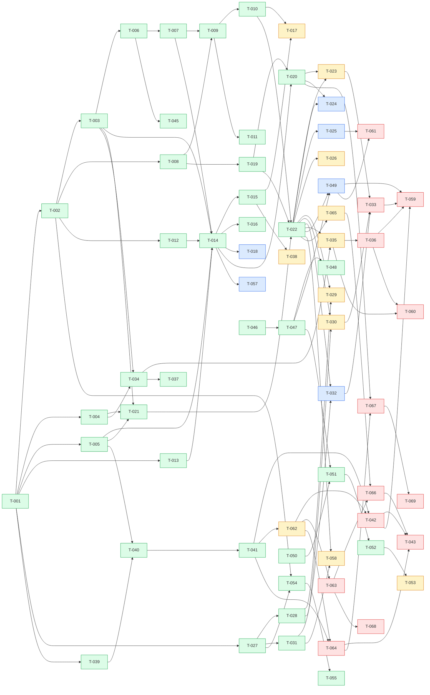

# Board

> Generated by `/kanban-board` from `kanban/tasks/*.md`. Don't edit by hand; the task files are the source of
> truth. Rules: `kanban/README.md`.

Updated: 2026-10-19 22:32 · Tasks: 69 total · backlog 6 · in-progress 11 · blocked 13 · review 0 · done 39

## Review (waiting for the user)

| ID | Title | Branch | In review since | Open questions |
|---|---|---|---|---|

## In progress

| ID | Title | Priority | Taken by | Owner | Branch | Since |
|---|---|---|---|---|---|---|
| T-023 | wallet.transfer on Algorand with opt-in steps | P0 | scholtz | session-20261019-agent | task/T-023 | 2026-10-19 22:32 |
| T-017 | Tier policy test suite | P1 | scholtz | session-20261019-agent | task/T-017 | 2026-10-19 22:32 |
| T-029 | dex.swap capability | P1 | scholtz | session-20261019-agent | task/T-029 | 2026-10-19 22:32 |
| T-030 | dex.addLiquidity and dex.removeLiquidity capabilities | P1 | scholtz | session-20261019-agent | task/T-030 | 2026-10-19 22:32 |
| T-035 | Record evidence across chat, previews and signing | P1 | scholtz | session-20261019-agent | task/T-035 | 2026-10-19 22:32 |
| T-038 | Public anonymous endpoint with continuation tokens | P1 | scholtz | session-20261019-agent | task/T-038 | 2026-10-19 22:32 |
| T-062 | Widget design foundations: Biatec AI tokens, Shadow DOM, theme sync, primitives | P1 | scholtz | session-20261019-agent | task/T-062 | 2026-10-19 22:32 |
| T-026 | limits.view and lowering-only limits.update | P2 | scholtz | session-20261019-agent | task/T-026 | 2026-10-19 22:32 |
| T-065 | Session agent mode (analyze / prepare) and pause, enforced server-side | P2 | scholtz | session-20261019-agent | task/T-065 | 2026-10-19 22:32 |
| T-053 | Authenticator push notifications | P3 | LukassSoukup | session-20261019-2300 | task/T-053 | 2026-10-19 23:00 |
| T-058 | x402.pay capability behind feature flag | P3 | scholtz | session-20261019-agent | task/T-058 | 2026-10-19 22:32 |

## Blocked

| ID | Title | Priority | Blocked by (not done yet) | Parallel | Taken by |
|---|---|---|---|---|---|
| T-042 | Widget action preview, consent and receipt cards | P0 | T-062 | no (T-036) | free |
| T-033 | safe.propose, approve and execute capabilities | P1 | T-023, T-030, T-032 | yes | free |
| T-036 | Evidence export bundle and offline verifier | P1 | T-035 | no (T-032, T-037, T-038, T-039, T-040, T-041, T-042, T-043, T-066) | free |
| T-059 | End-to-end demo test on testnet | P1 | T-033, T-036, T-042, T-049 | yes | free |
| T-063 | Widget shell: launcher, panel modes, header and host API | P1 | T-062 | no (T-064) | free |
| T-064 | Widget conversation UI to the Biatec AI design | P1 | T-062 | no (T-063) | free |
| T-043 | Widget Slovak translation and accessibility pass | P2 | T-042, T-064, T-066 | no (T-036) | free |
| T-066 | Widget permissions dialog, pause/revoke and activity timeline | P2 | T-063, T-065 | no (T-036) | free |
| T-068 | BiatecDEX integration playground and hand-off doc | P2 | T-063 | yes | free |
| T-060 | Retention jobs and user erasure | P3 | T-035, T-036 | no (T-032, T-038) | free |
| T-061 | Backend fallback cap for users without an active device | P3 | T-025, T-049 | yes | free |
| T-067 | Holdings data card from wallet.balance | P3 | T-064 | no (T-065) | free |
| T-069 | market.snapshot capability and market card from Biatec DEX data | P3 | T-067 | no (T-065) | free |

## Backlog

Sorted by priority, then ID. The first row is what `/kanban-next` picks.

| ID | Title | Priority | Epic | Parallel | Taken by |
|---|---|---|---|---|---|
| T-024 | wallet.transfer on Bitcoin (PSBT intent hash) | P1 | Wallet tools | no (T-025, T-035, T-049, T-057) | free |
| T-032 | safe.create and safe.list capabilities | P1 | Safe | no (T-036, T-038, T-060) | free |
| T-049 | Backend consent orchestrator | P1 | Consent & authenticator | no (T-014, T-024, T-025, T-035, T-057) | free |
| T-018 | Bedrock budget and circuit breaker | P2 | Orchestrator | no (T-016, T-035, T-057) | free |
| T-025 | Tenant soft cap and safe approval caps | P2 | Wallet tools | no (T-024, T-035, T-049, T-057) | free |
| T-057 | OpenTelemetry traces and metrics | P3 | Deploy & docs | no (T-016, T-018, T-019, T-022, T-024, T-025, T-027, T-035, T-049) | free |

## Done

| ID | Title | Approved on |
|---|---|---|
| T-001 | Scaffold monorepo and backend solution | 2026-10-19 |
| T-002 | Backend config, options and health endpoint | 2026-10-19 |
| T-003 | EF Core data model and migrations | 2026-10-19 |
| T-004 | RFC 8785 canonical JSON and hashing library | 2026-10-19 |
| T-005 | chat-protocol package generated from backend OpenAPI | 2026-10-19 |
| T-006 | Tenant resolution, CORS and CSRF guard | 2026-10-19 |
| T-007 | Cookie session, probe and keepalive | 2026-10-19 |
| T-008 | Encrypted token vault in Redis | 2026-10-19 |
| T-009 | OAuth BFF login with PKCE and popup | 2026-10-19 |
| T-010 | Scope elevation for sign and manage-limits | 2026-10-19 |
| T-011 | Logout, sweeper and pending revocation | 2026-10-19 |
| T-012 | Bedrock Converse streaming client | 2026-10-19 |
| T-013 | Capability registry and tier gate | 2026-10-19 |
| T-014 | Conversation orchestrator and SSE chat endpoint | 2026-10-19 |
| T-015 | Anonymous tier: requestSignIn and knowledge base search | 2026-10-19 |
| T-016 | Bedrock Guardrails on model and tool results | 2026-10-19 |
| T-019 | Biatec MCP client with lazy tool cache | 2026-10-19 |
| T-020 | wallet.listAddresses and wallet.balance | 2026-10-19 |
| T-021 | Action preview, group hash and expiry | 2026-10-19 |
| T-022 | Confirm, sign at Biatec OIDC and submit | 2026-10-19 |
| T-027 | Node builder sidecar for CLAMM and algo-safe | 2026-10-19 |
| T-028 | Pool discovery and liquidity builders | 2026-10-19 |
| T-031 | Safe builders in sidecar (algo-safe) | 2026-10-19 |
| T-034 | Evidence log hash chain and signing keys | 2026-10-19 |
| T-037 | On-chain evidence anchoring | 2026-10-19 |
| T-039 | Widget package scaffold, launcher and panel | 2026-10-19 |
| T-040 | Widget transport: cookie probe, public fallback, SSE | 2026-10-19 |
| T-041 | Widget chat UI and sign-in popup | 2026-10-19 |
| T-044 | Required OIDC changes handoff document | 2026-10-19 |
| T-045 | Tenant onboarding API with domain verification | 2026-10-19 |
| T-046 | Consent protocol spec, schemas and test vectors | 2026-10-19 |
| T-047 | Mock Biatec OIDC consent server | 2026-10-19 |
| T-048 | Consent conformance test suite | 2026-10-19 |
| T-050 | Authenticator Flutter app scaffold | 2026-10-19 |
| T-051 | Authenticator enrollment and device key | 2026-10-19 |
| T-052 | Authenticator approval flow and receipts | 2026-10-19 |
| T-054 | Containers and k8s manifests | 2026-10-19 |
| T-055 | Hackathon AWS hosting plan and scripts | 2026-10-19 |
| T-056 | Architecture, threat model and demo docs | 2026-10-19 |

## Dependency graph

## Board warnings

none
